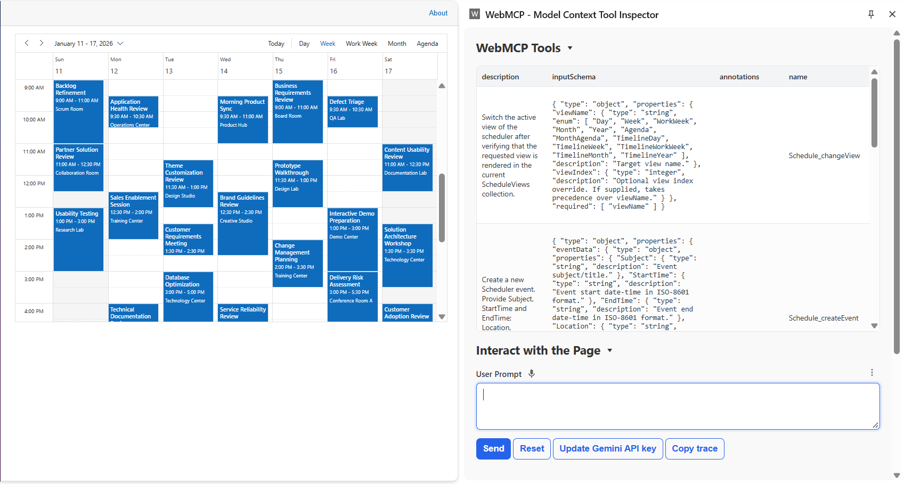
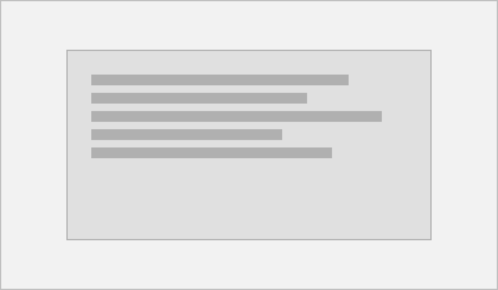
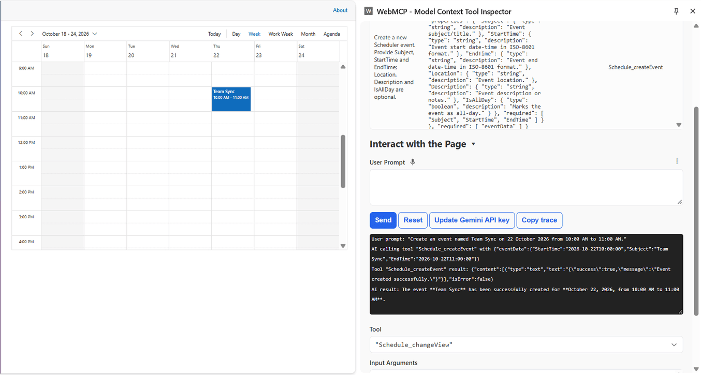

# Getting Started with WebMCP

Enable WebMCP on the Blazor Scheduler with one property, then confirm its tools are registered in the browser. This example uses the Scheduler component.

## Prerequisites

Before you begin, ensure you have:

* A Blazor app with the Syncfusion<sup style="font-size:70%">&reg;</sup> Scheduler component already rendering. Use an interactive render mode. Static SSR does not run the browser registration. See [interactive render mode](https://blazor.syncfusion.com/documentation/common/interactive-render-mode).
* A Chromium-based browser with the WebMCP origin trial or `chrome://flags/#enable-webmcp` enabled. The API is experimental, so confirm it in the browser versions you support.

## Enable WebMCP

Set `EnableWebMcp` to `true`. Optionally set `Name` on the component's `ScheduleWebMcpSettings` tag so tool names stay unique on the page.

```cshtml

@page "/"
@using Syncfusion.Blazor.Schedule;

<SfSchedule TValue="AppointmentData"
            Height="650px"
            SelectedDate="@SelectedDate"
            EnableWebMcp="true">
    <ScheduleEventSettings TValue="AppointmentData"
                           DataSource="@Appointments">
    </ScheduleEventSettings>
    <ScheduleWebMcpSettings Name="Schedule">
    </ScheduleWebMcpSettings>
</SfSchedule>

@code {
    private readonly DateTime SelectedDate =
        new DateTime(2026, 10, 22);

    private readonly List<AppointmentData> Appointments = new();

    public class AppointmentData
    {
        public int Id { get; set; }

        public string? Subject { get; set; }

        public string? Location { get; set; }

        public string? Description { get; set; }

        public DateTime StartTime { get; set; }

        public DateTime EndTime { get; set; }

        public bool IsAllDay { get; set; }
    }
}

```

`EnableWebMcp` turns registration on. `Name` becomes the prefix for the tool names. If you omit it, the component `ID` is used, then a generated ID.



## Verify the tools

Call `GetWebMcpToolsAsync` to list the tools the component registered.

```cshtml

@page "/"
@using Syncfusion.Blazor.Schedule;

<button class="e-btn" @onclick="ShowToolsAsync">List WebMCP tools</button>

<ul>
    @foreach (var line in ToolLines)
    {
        <li>@line</li>
    }
</ul>

<SfSchedule TValue="AppointmentData"
            Height="650px"
            SelectedDate="@SelectedDate"
            EnableWebMcp="true"
            @ref="ScheduleRef">
    <ScheduleEventSettings TValue="AppointmentData"
                           DataSource="@Appointments">
    </ScheduleEventSettings>
    <ScheduleWebMcpSettings Name="Schedule">
    </ScheduleWebMcpSettings>
</SfSchedule>

@code {
    private SfSchedule<AppointmentData>? ScheduleRef;
    private List<string> ToolLines = new();

    private readonly DateTime SelectedDate =
        new DateTime(2026, 10, 22);

    private readonly List<AppointmentData> Appointments = new();

    public class AppointmentData
    {
        public int Id { get; set; }

        public string? Subject { get; set; }

        public string? Location { get; set; }

        public string? Description { get; set; }

        public DateTime StartTime { get; set; }

        public DateTime EndTime { get; set; }

        public bool IsAllDay { get; set; }
    }

    private async Task ShowToolsAsync()
    {
        if (ScheduleRef is null) return;
        var tools = await ScheduleRef.GetWebMcpToolsAsync();
        ToolLines = tools.Select(t => $"{t.Name}: {t.Description}").ToList();
    }
}

```

Pass a list of names to `GetWebMcpToolsAsync` to inspect specific tools only.


## Supported tools

The Blazor Scheduler ships built-in WebMCP tools for navigation and for write operations.

### Navigate Tools

| Tool Name | Description |
| --------- | ----------- |
| changeView | Switches the Scheduler to the requested view |
| navigateDate | Moves the Scheduler to the requested date |

### Write Tools

| Tool Name | Description |
| --------- | ----------- |
| createEvent | Adds a new event to the Scheduler |
| updateEvent | Updates an existing event, identified by its subject and optional start and end times |
| deleteEvent | Deletes an existing event, identified by its subject and optional start and end times |

## Configure tools

Each Scheduler ships the built-in tools listed above. You can enable, disable, or rename them, add custom tools, and handle every call in `OnWebMcpExecute`. Tools are declared inside `ScheduleWebMcpSettings` > `ScheduleWebMcpTools` > `ScheduleWebMcpTool` child tags.

A built-in tool is selected with `Command`. The properties below apply to every tool entry.

| Property | Purpose | Default |
| --- | --- | --- |
| `Command` | Built-in command to configure, or `Custom` for your own tool | `None` |
| `Name` | Registered tool name. Required for custom tools. Optional override for built-in tools. Use camelCase, for example `getCurrentInfo` | Generated |
| `Description` | Text the agent reads to decide when to call the tool | Built-in text |
| `InputSchema` | JSON Schema for the tool's input as a JSON string | Built-in schema |
| `Enabled` | Whether the tool is registered with the browser. Set it to `false` to keep a tool out of registration | `true` |

Every tool registers by default, so `Enabled` only needs to appear when you exclude a tool. Setting `Enabled="false"` on an entry keeps that tool out of the browser registration; the other tools still register.

The name registered with the browser is `{Prefix}_{Tool}`. The prefix is the `Name` on `ScheduleWebMcpSettings`, or the component `ID` when `Name` is empty. The tool part is the built-in command, or the `Name` you set on a custom tool. With `Name="Schedule"`, the built-in `createEvent` tool is registered as `Schedule_createEvent`, and a custom tool named `getCurrentInfo` is registered as `Schedule_getCurrentInfo`.

`args.Name` in `OnWebMcpExecute` and the `Name` on each item returned by `GetWebMcpToolsAsync` are the tool name without the prefix. Match on that value, or on `args.Command`, when you decide which call to handle.

```cshtml

@page "/"
@using Syncfusion.Blazor.Schedule;

<SfSchedule TValue="AppointmentData"
            Height="650px"
            SelectedDate="@SelectedDate"
            EnableWebMcp="true">
    <ScheduleEvents TValue="AppointmentData"
                    OnWebMcpExecute="OnWebMcpExecute">
    </ScheduleEvents>
    <ScheduleEventSettings TValue="AppointmentData"
                           DataSource="@Appointments">
    </ScheduleEventSettings>
    <ScheduleWebMcpSettings Name="Schedule">
        <ScheduleWebMcpTools>
            <ScheduleWebMcpTool Command="@ScheduleWebMcpToolCommand.DeleteEvent"
                                Enabled="false" />
            <ScheduleWebMcpTool Command="@ScheduleWebMcpToolCommand.NavigateDate"
                                Name="goToDate"
                                Description="Moves the Scheduler to the requested calendar date." />
            <ScheduleWebMcpTool Command="@ScheduleWebMcpToolCommand.Custom"
                                Name="getCurrentInfo"
                                Description="Return the current view and selected date of the Scheduler."
                                InputSchema="@EmptySchema" />
        </ScheduleWebMcpTools>
    </ScheduleWebMcpSettings>
</SfSchedule>

@code {
    private readonly DateTime SelectedDate =
        new DateTime(2026, 10, 22);

    private readonly List<AppointmentData> Appointments = new();

    private string EmptySchema = """{"type":"object","properties":{}}""";

    public class AppointmentData
    {
        public int Id { get; set; }

        public string? Subject { get; set; }

        public string? Location { get; set; }

        public string? Description { get; set; }

        public DateTime StartTime { get; set; }

        public DateTime EndTime { get; set; }

        public bool IsAllDay { get; set; }
    }

    private Task OnWebMcpExecute(ScheduleWebMcpExecuteEventArgs args)
    {
        return Task.CompletedTask;
    }
}

```

## Custom tools

Set `Command` to `Custom` to expose an action the component does not provide. A custom tool needs a `Name`, a `Description`, and an `InputSchema`. Handle the call in `OnWebMcpExecute`, match `args.Name`, and set `args.Result`.

The following sample registers a custom tool that returns the current view and selected date of the Scheduler. The tool takes no input, so its schema declares no properties.

```cshtml

@page "/"
@using System.Globalization;
@using Syncfusion.Blazor.Schedule;

<SfSchedule TValue="AppointmentData"
            Height="650px"
            SelectedDate="@SelectedDate"
            EnableWebMcp="true"
            @ref="ScheduleRef">
    <ScheduleEvents TValue="AppointmentData"
                    OnWebMcpExecute="OnWebMcpExecute">
    </ScheduleEvents>
    <ScheduleEventSettings TValue="AppointmentData"
                           DataSource="@Appointments">
    </ScheduleEventSettings>
    <ScheduleWebMcpSettings Name="@SchedulePrefix">
        <ScheduleWebMcpTools>
            <ScheduleWebMcpTool Command="@ScheduleWebMcpToolCommand.Custom"
                                Name="@CustomToolName"
                                Description="@CustomToolDescription"
                                InputSchema="@CustomInputSchema" />
        </ScheduleWebMcpTools>
    </ScheduleWebMcpSettings>
</SfSchedule>

@code {
    private SfSchedule<AppointmentData>? ScheduleRef;

    private readonly DateTime SelectedDate =
        new DateTime(2026, 10, 22);

    private readonly List<AppointmentData> Appointments = new();

    private string SchedulePrefix => "Schedule";

    private string CustomToolName => "getCurrentInfo";

    private string CustomToolDescription =>
        "Gets the current view and selected date of the Scheduler.";

    private string CustomInputSchema =>
        @"
    {
        ""type"": ""object"",
        ""properties"": {},
        ""required"": []
    }";

    public class AppointmentData
    {
        public int Id { get; set; }

        public string? Subject { get; set; }

        public string? Location { get; set; }

        public string? Description { get; set; }

        public DateTime StartTime { get; set; }

        public DateTime EndTime { get; set; }

        public bool IsAllDay { get; set; }
    }

    private Task OnWebMcpExecute(ScheduleWebMcpExecuteEventArgs args)
    {
        if (args.Command != ScheduleWebMcpToolCommand.Custom)
        {
            return Task.CompletedTask;
        }

        if (!string.Equals(
                args.Name,
                CustomToolName,
                StringComparison.OrdinalIgnoreCase))
        {
            return Task.CompletedTask;
        }

        if (ScheduleRef is null)
        {
            args.Cancel = true;
            args.CancellationResponse =
                "The Scheduler component is not available.";

            return Task.CompletedTask;
        }

        string selectedDate = ScheduleRef.SelectedDate.ToString(
            "MMMM dd, yyyy",
            CultureInfo.InvariantCulture);

        args.Result =
            $"The Scheduler is currently displaying the " +
            $"{ScheduleRef.CurrentView} view with " +
            $"{selectedDate} selected.";

        return Task.CompletedTask;
    }
}

```


## Control tool execution

Every call triggers `OnWebMcpExecute`. The event arguments expose `Command`, `Name`, `Arguments`, `ShowConfirmationDialog`, `Cancel`, `CancellationResponse`, and `Result`.

The order of work for each call is:

1. The component resolves the tool.
2. `OnWebMcpExecute` runs.
3. If `Cancel` is `true`, execution stops and a cancellation response is returned.
4. If `ShowConfirmationDialog` is `true`, the component asks the user to confirm a built-in tool.
5. For a built-in tool, the component handler runs and returns the result. For a custom tool, the result is the value you set on `Result` in this event.

For a built-in write tool, set `ShowConfirmationDialog` and leave the work to the component. Do not change data in the event for that call. The component runs its handler only after the user accepts. The confirmation gate applies to built-in tools only, because a custom tool has already run its side effect by the time the event returns.

```cshtml

@page "/"
@using Syncfusion.Blazor.Schedule;

<SfSchedule TValue="AppointmentData"
            Height="650px"
            SelectedDate="@SelectedDate"
            EnableWebMcp="true">
    <ScheduleEvents TValue="AppointmentData"
                    OnWebMcpExecute="OnWebMcpExecute">
    </ScheduleEvents>
    <ScheduleEventSettings TValue="AppointmentData"
                           DataSource="@Appointments">
    </ScheduleEventSettings>
    <ScheduleWebMcpSettings Name="@SchedulePrefix">
        <ScheduleWebMcpTools>
            <ScheduleWebMcpTool Command="@ScheduleWebMcpToolCommand.NavigateDate"
                                Name="@NavigateDateToolName"
                                Description="@NavigateDateDescription" />
        </ScheduleWebMcpTools>
    </ScheduleWebMcpSettings>
</SfSchedule>

@code {
    private readonly DateTime SelectedDate =
        new DateTime(2026, 10, 22);

    private readonly List<AppointmentData> Appointments = new();

    private string SchedulePrefix => "Schedule";

    private string NavigateDateToolName => "navigateDate";

    private string NavigateDateDescription =>
        "Navigates the Scheduler to a specific date.";

    private string CustomToolName => "getCurrentInfo";

    private bool UserCanEditEvents { get; set; } = true;

    public class AppointmentData
    {
        public int Id { get; set; }

        public string? Subject { get; set; }

        public string? Location { get; set; }

        public string? Description { get; set; }

        public DateTime StartTime { get; set; }

        public DateTime EndTime { get; set; }

        public bool IsAllDay { get; set; }
    }

    private Task OnWebMcpExecute(ScheduleWebMcpExecuteEventArgs args)
    {
        // Block a write tool when the user is not allowed to change events.
        if (args.Command == ScheduleWebMcpToolCommand.DeleteEvent &&
            !UserCanEditEvents)
        {
            args.Cancel = true;
            args.CancellationResponse =
                "Deleting events is not allowed for this user.";

            return Task.CompletedTask;
        }

        // Ask the user to confirm before a built-in tool changes the schedule.
        if (args.Command == ScheduleWebMcpToolCommand.NavigateDate)
        {
            args.ShowConfirmationDialog = true;

            return Task.CompletedTask;
        }

        // Custom tool sample.
        if (args.Command != ScheduleWebMcpToolCommand.Custom)
        {
            return Task.CompletedTask;
        }

        if (!string.Equals(
                args.Name,
                CustomToolName,
                StringComparison.OrdinalIgnoreCase))
        {
            return Task.CompletedTask;
        }

        args.Result = "The Scheduler is ready.";

        return Task.CompletedTask;
    }
}

```



## Inspect tools

`GetWebMcpToolsAsync(IEnumerable<string>? toolNames = null)` returns the registered tools as `IWebMcpTool` items with `Name`, `Description`, and `InputSchema`. Use it to confirm which tools an agent can see.

## Try a first prompt

With your agent connected, ask for something the component can do, for example "Create an event named Team Sync on 22 October 2026 from 10:00 AM to 11:00 AM." The agent picks the matching tool, the component runs it, and the Scheduler changes on screen.



## See also

* [WebMCP overview](https://blazor.syncfusion.com/documentation/webmcp/overview) explains how a component registers tools and how an agent calls them.
