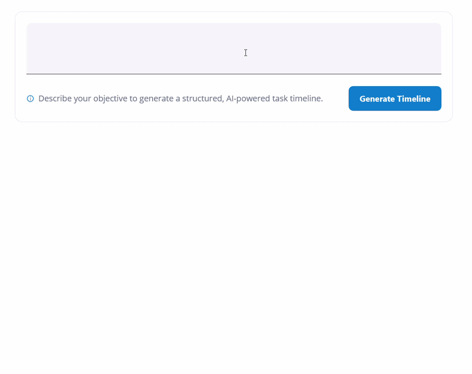

# AI-Powered Smart TimeLine Generator in .NET MAUI Scheduler

This guide explains how to implement AI-powered TimeLine Generator in a .NET MAUI application using Syncfusion® Scheduler (`SfScheduler`) and Azure OpenAI.

Users can enter a high-level objective such as planning an event, launching a product, or managing a project. Azure OpenAI analyzes the request and automatically generates a structured timeline of project activities with dates and descriptions.

## Integrating AI-Powered Smart TimeLine Generator in .NET MAUI Scheduler

Before proceeding, ensure that Azure OpenAI is configured and integrated with your .NET MAUI application. Refer to the **Azure OpenAI integration prerequisites** and complete the required setup steps.

The `GeneratePlanAsync` method sends the user's goal to Azure OpenAI and retrieves a structured timeline containing project tasks, dates, and descriptions.




public async Task<AIPlannerResponse?> GeneratePlanAsync(string userInput, CancellationToken cancellationToken = default)
{
    string currentDate = DateTime.Today.ToString("yyyy-MM-dd", CultureInfo.InvariantCulture);

    string systemPrompt =
        $$"""
        You are an AI Project Planner.

        Convert the user's high-level goal into
        a practical timeline of tasks.

        Today's date is:

        {{currentDate}}

        Generate between 5 and 7 meaningful tasks.

        Each task must contain:

        TaskName
        StartDate
        EndDate
        Description

        Return ONLY valid JSON.
        """;

    string userPrompt =
        $$"""
        Create a project timeline for this goal:

        {{userInput}}
        """;

    List<ChatMessage> messages =
    [
        new SystemChatMessage(systemPrompt),
        new UserChatMessage(userPrompt)
    ];

    ChatCompletionOptions options =
        new()
        {
            ResponseFormat =
                ChatResponseFormat
                    .CreateJsonObjectFormat()
        };

    ClientResult<ChatCompletion> result = await _chatClient!.CompleteChatAsync(messages, options, cancellationToken);
    string json = string.Concat(result.Value.Content.Select(part => part.Text ?? string.Empty));
    return JsonSerializer.Deserialize<AIPlannerResponse>(json, JsonOptions);
}




## Step 1: Designing the User Interface

Use an `Editor` to collect TimeLine Generator requirements and a button to generate the timeline.




<core:SfTextInputLayout
    ContainerType="Filled"
    ShowHint="False">

    <Editor
        Text="{Binding UserInput}"
        Placeholder="Example: Organize a company event next month." />

</core:SfTextInputLayout>

<buttons:SfButton
    Text="Generate Timeline"
    Command="{Binding GenerateTimelineCommand}" />




The `SfBusyIndicator` provides visual feedback while Azure OpenAI generates the timeline.




<core:SfBusyIndicator
    IsRunning="{Binding IsBusy}"
    AnimationType="CircularMaterial" />




---

## Step 2: Generate Project Activities Using Azure OpenAI

Create a command to start the AI-powered timeline generation process.




[RelayCommand]
public async Task GenerateTimelineAsync()
{
    if (string.IsNullOrWhiteSpace(UserInput))
    {
        return;
    }

    IsBusy = true;
    var response = await plannerService.GeneratePlanAsync(UserInput);
    IsBusy = false;
}




## Step 3: Display the Final Timeline in Scheduler

The `SfScheduler` displays the finalized project plan as appointments.




<scheduler:SfScheduler
    DisplayDate="{Binding DisplayDate}"
    AppointmentsSource="{Binding Appointments}"
    View="Month">

    <scheduler:SfScheduler.MonthView>
        <scheduler:SchedulerMonthView
            ShowLeadingAndTrailingDates="True"
            ShowAppointmentsInline="True"
            AppointmentDisplayMode="Text" />
    </scheduler:SfScheduler.MonthView>

</scheduler:SfScheduler>




With these implementations, the Scheduler becomes AI-powered, enabling users to generate practical project plans dynamically through Azure OpenAI.

Azure OpenAI analyzes the project objective, identifies meaningful activities, assigns logical dates and durations, and generates a complete project timeline. Users can review and refine the generated schedule before applying it to the Scheduler.

images/smart-ai-samples/AI-Powered-Smart-Project-Planning-Scheduler.gif

You can download the complete sample from this [link]().