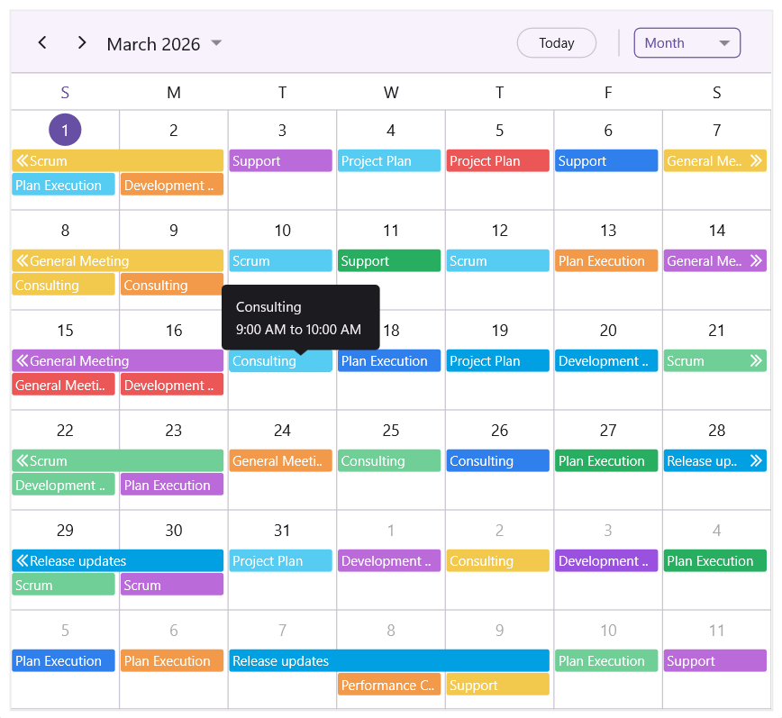
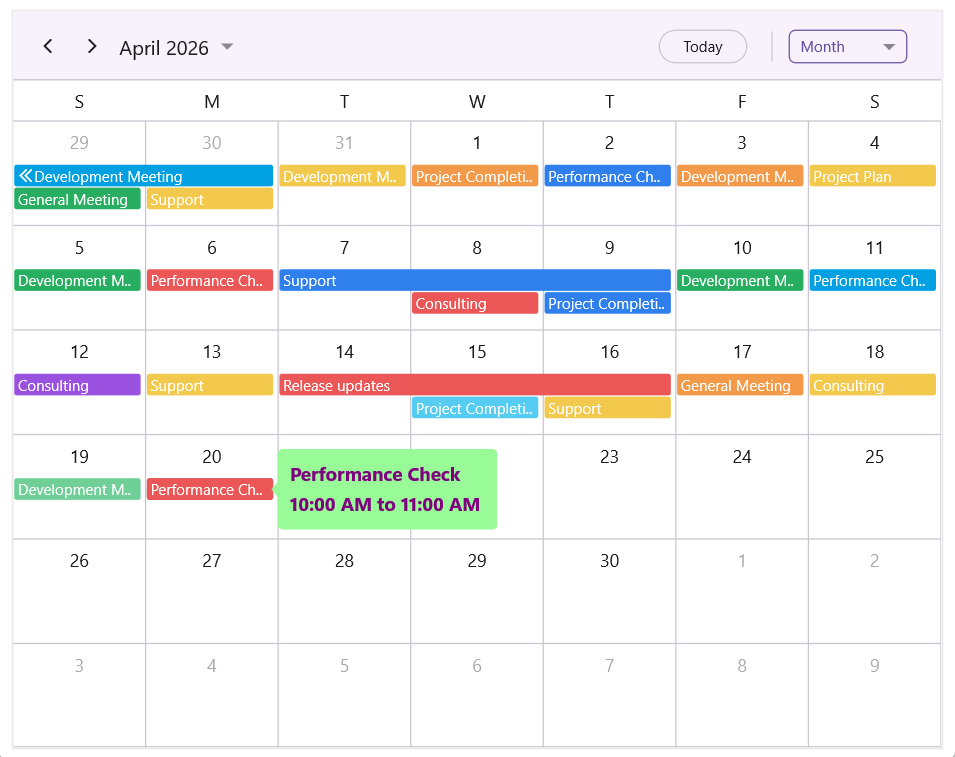
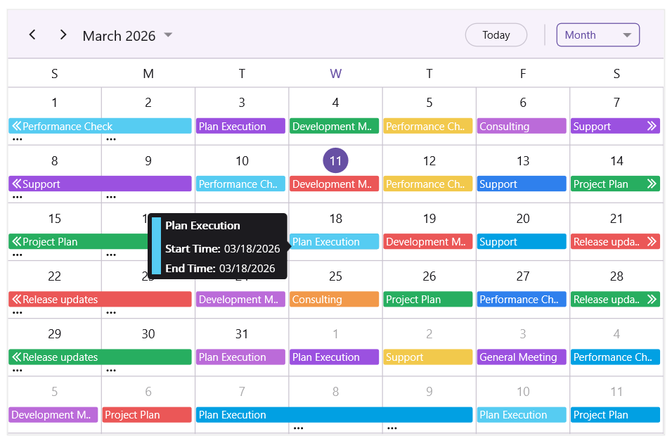
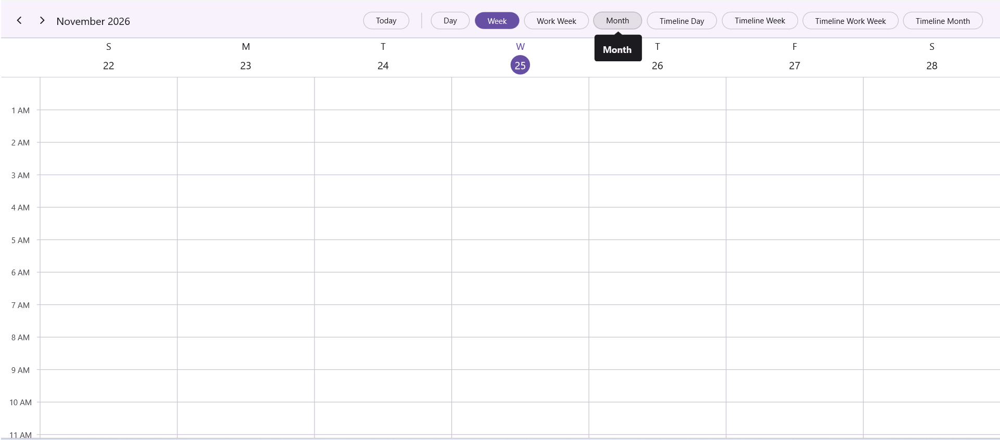

# Appointment Tooltip in .NET MAUI Scheduler

The appointment tooltip provides a quick, contextual preview of scheduled events. By default, the [IsAppointmentToolTipEnabled](https://help.syncfusion.com/cr/maui/Syncfusion.Maui.Scheduler.SfScheduler.html#Syncfusion_Maui_Scheduler_SfScheduler_IsAppointmentToolTipEnabled) property is set to `false`. To display appointment details such as the subject, start time, and end time when hovering over or tapping an appointment, set the `IsAppointmentToolTipEnabled` property to `true`.



<ContentPage   
    . . .
    xmlns:scheduler="clr-namespace:Syncfusion.Maui.Scheduler;assembly=Syncfusion.Maui.Scheduler">
    <scheduler:SfScheduler x:Name="scheduler" 
                           View="Day" 
                           IsAppointmentToolTipEnabled="True">
    </scheduler:SfScheduler>
</ContentPage>


using Syncfusion.Maui.Scheduler;

. . .
public partial class MainPage : ContentPage
{
    public MainPage()
    {
        InitializeComponent();
        this.scheduler.IsAppointmentToolTipEnabled = true;
    }
}



N>
- **Desktop platforms**: A tooltip is shown when you hover the mouse over an appointment.
- **Mobile platforms**: A tooltip is shown when you tap or long‑press an appointment. The tooltip appears on long‑press only when appointment dragging is disabled.

## Appointment Tooltip Settings

The [AppointmentToolTipSettings](https://help.syncfusion.com/cr/maui/Syncfusion.Maui.Scheduler.SfScheduler.html#Syncfusion_Maui_Scheduler_SfScheduler_AppointmentToolTipSettings) property allows you to customize the appearance and behavior of appointment tooltips. The following settings can be configured:
 
- **Background** – Defines the background color of the tooltip. Accepts a `Color` value (for example, a named color such as `"PaleGreen"`, `Colors.PaleGreen`, or a hex string) or a `Brush` value (for example, `SolidColorBrush`, `LinearGradientBrush`).
 
- **TextStyle** – Specifies the text styling of the tooltip content. The [`SchedulerTextStyle`](https://help.syncfusion.com/cr/maui/Syncfusion.Maui.Scheduler.SchedulerTextStyle.html) exposes `TextColor`, `FontSize`, `FontAttributes`, `FontFamily`, `FontAutoScalingEnabled`, `LineBreakMode`, and other text-related properties.
 
- **Padding** – Specifies the spacing inside the tooltip.
 
- **ToolTipPosition** – Determines the placement of the tooltip relative to the appointment. Supported values are defined by the [`SchedulerToolTipPosition`](https://help.syncfusion.com/cr/maui/Syncfusion.Maui.Scheduler.SchedulerToolTipPosition.html) enum and include Auto (default), Left, Right, Top, and Bottom.



<ContentPage   
    . . .
    xmlns:scheduler="clr-namespace:Syncfusion.Maui.Scheduler;assembly=Syncfusion.Maui.Scheduler">
    <scheduler:SfScheduler x:Name="scheduler" 
                           View="Day" 
                           IsAppointmentToolTipEnabled="True">
        <scheduler:SfScheduler.AppointmentToolTipSettings>
            <scheduler:AppointmentToolTipSettings Background="PaleGreen" Padding="5" ToolTipPosition="Right">
                <scheduler:AppointmentToolTipSettings.TextStyle>
                    <scheduler:SchedulerTextStyle TextColor="Purple" FontSize="15" FontAttributes="Bold"/>
                </scheduler:AppointmentToolTipSettings.TextStyle>
            </scheduler:AppointmentToolTipSettings>
        </scheduler:SfScheduler.AppointmentToolTipSettings>
    </scheduler:SfScheduler>
</ContentPage>


using Syncfusion.Maui.Scheduler;

. . .
public partial class MainPage : ContentPage
{
    public MainPage()
    {
        InitializeComponent();
        this.scheduler.IsAppointmentToolTipEnabled = true;
        this.scheduler.AppointmentToolTipSettings = new AppointmentToolTipSettings()
        {
            Background = Colors.PaleGreen,
            Padding = new Thickness(5),
            ToolTipPosition = SchedulerToolTipPosition.Right,
            TextStyle = new SchedulerTextStyle
            {
                TextColor = Colors.Purple,
                FontSize = 15,
                FontAttributes = FontAttributes.Bold
            }
        };
    }
}



## Appointment ToolTip Template

The [AppointmentToolTipTemplate](https://help.syncfusion.com/cr/maui/Syncfusion.Maui.Scheduler.SfScheduler.html#Syncfusion_Maui_Scheduler_SfScheduler_AppointmentToolTipTemplate) property lets you create a custom tooltip layout for appointments, allowing you to display additional information or change the tooltip’s appearance as needed.



<ContentPage   
    . . .
    xmlns:scheduler="clr-namespace:Syncfusion.Maui.Scheduler;assembly=Syncfusion.Maui.Scheduler">
    <scheduler:SfScheduler x:Name="scheduler" 
                           View="Day" 
                           IsAppointmentToolTipEnabled="True">
        <scheduler:SfScheduler.AppointmentToolTipSettings>
            <scheduler:AppointmentToolTipSettings ToolTipPosition="Left"/>
        </scheduler:SfScheduler.AppointmentToolTipSettings>

        <scheduler:SfScheduler.AppointmentToolTipTemplate>
            <DataTemplate x:DataType="scheduler:SchedulerAppointment">
                <Grid ColumnDefinitions="Auto,*">
                    <BoxView Grid.Column="0"
                             Background="{Binding Background}"
                             WidthRequest="10"
                             HorizontalOptions="Start"
                             VerticalOptions="Fill"
                             Margin="0,0,5,0" />

                    <VerticalStackLayout Grid.Column="1" Spacing="5">
                        <Label Text="{Binding Subject}"
                               FontAttributes="Bold"
                               FontSize="12"
                               TextColor="White"
                               LineBreakMode="TailTruncation"
                               MaxLines="2"
                               Margin="0,0,0,5" />

                        <HorizontalStackLayout Spacing="4">
                            <Label Text="Start Time: "
                                   FontAttributes="Bold"
                                   FontSize="12"
                                   TextColor="White" />
                            <Label Text="{Binding StartTime, StringFormat='{0:MM/dd/yyyy}'}"
                                   FontSize="12"
                                   TextColor="White" />
                        </HorizontalStackLayout>

                        <HorizontalStackLayout Spacing="4">
                            <Label Text="End Time: "
                                   FontAttributes="Bold"
                                   FontSize="12"
                                   TextColor="White" />
                            <Label Text="{Binding EndTime, StringFormat='{0:MM/dd/yyyy}'}"
                                   FontSize="12"
                                   TextColor="White" />
                        </HorizontalStackLayout>
                    </VerticalStackLayout>
                </Grid>
            </DataTemplate>
        </scheduler:SfScheduler.AppointmentToolTipTemplate>
    </scheduler:SfScheduler>
</ContentPage>



## Header Tooltip

The header tooltip shows a short plain-text description for the built-in elements of the scheduler header. By default, the [IsHeaderToolTipEnabled](https://help.syncfusion.com/cr/maui/Syncfusion.Maui.Scheduler.SchedulerHeaderView.html#Syncfusion_Maui_Scheduler_SchedulerHeaderView_IsHeaderToolTipEnabled) property of the [SchedulerHeaderView](https://help.syncfusion.com/cr/maui/Syncfusion.Maui.Scheduler.SchedulerHeaderView.html) is set to `false`. To display the tooltips, set the `IsHeaderToolTipEnabled` property to `true`.



<ContentPage   
    . . .
    xmlns:scheduler="clr-namespace:Syncfusion.Maui.Scheduler;assembly=Syncfusion.Maui.Scheduler">
    <scheduler:SfScheduler x:Name="scheduler" 
                           View="Week">
        <scheduler:SfScheduler.HeaderView>
            <scheduler:SchedulerHeaderView 
                IsHeaderToolTipEnabled="True"/>
        </scheduler:SfScheduler.HeaderView>
    </scheduler:SfScheduler>
</ContentPage>


using Syncfusion.Maui.Scheduler;

. . .
public partial class MainPage : ContentPage
{
    public MainPage()
    {
        InitializeComponent();
        this.scheduler.HeaderView.IsHeaderToolTipEnabled = true;
    }
}



The tooltip is available for the following header elements:

- Previous navigation button
- Next navigation button
- Today button
- Date-picker button
- Allowed-view selector items (Day, Week, Month, and so on)
- More-icon button (shown when the allowed views overflow)

The tooltip text is the localized display text of the element. For a view item, it is the view name, for example "Day", "Week", or "Month". The header layout is the same whether the tooltips are on or off.

N>
- **Desktop platforms**: A tooltip is shown when you hover the mouse over a header element.

### Header Tooltip Settings

The [HeaderToolTipSettings](https://help.syncfusion.com/cr/maui/Syncfusion.Maui.Scheduler.SchedulerHeaderView.html#Syncfusion_Maui_Scheduler_SchedulerHeaderView_HeaderToolTipSettings) property allows you to customize the appearance of header tooltips. It applies only when `IsHeaderToolTipEnabled` is `true`. The following settings can be configured:

- **Background** – Defines the background of the tooltip. The default value is `#1C1B1F`.

- **TextStyle** – Specifies the text styling of the tooltip content. The [`SchedulerTextStyle`](https://help.syncfusion.com/cr/maui/Syncfusion.Maui.Scheduler.SchedulerTextStyle.html) exposes `TextColor`, `FontSize`, `FontAttributes`, `FontFamily`, and other text-related properties. By default, the `TextColor` is `#F4EFF4`.

- **Padding** – Specifies the spacing between the text and the tooltip edge. The default value is `12,8,12,8`.



<ContentPage   
    . . .
    xmlns:scheduler="clr-namespace:Syncfusion.Maui.Scheduler;assembly=Syncfusion.Maui.Scheduler">
    <scheduler:SfScheduler x:Name="scheduler" 
                           View="Week">
        <scheduler:SfScheduler.HeaderView>
            <scheduler:SchedulerHeaderView IsHeaderToolTipEnabled="True">
                <scheduler:SchedulerHeaderView.HeaderToolTipSettings>
                    <scheduler:HeaderToolTipSettings Background="PaleGreen" Padding="5">
                        <scheduler:HeaderToolTipSettings.TextStyle>
                            <scheduler:SchedulerTextStyle TextColor="Purple" FontSize="15" FontAttributes="Bold"/>
                        </scheduler:HeaderToolTipSettings.TextStyle>
                    </scheduler:HeaderToolTipSettings>
                </scheduler:SchedulerHeaderView.HeaderToolTipSettings>
            </scheduler:SchedulerHeaderView>
        </scheduler:SfScheduler.HeaderView>
    </scheduler:SfScheduler>
</ContentPage>


using Syncfusion.Maui.Scheduler;

. . .
public partial class MainPage : ContentPage
{
    public MainPage()
    {
        InitializeComponent();
        this.scheduler.HeaderView.IsHeaderToolTipEnabled = true;
        this.scheduler.HeaderView.HeaderToolTipSettings = new HeaderToolTipSettings()
        {
            Background = Colors.PaleGreen,
            Padding = new Thickness(5),
            TextStyle = new SchedulerTextStyle
            {
                TextColor = Colors.Purple,
                FontSize = 15,
                FontAttributes = FontAttributes.Bold
            }
        };
    }
}



### Header Tooltip Template

The [HeaderToolTipTemplate](https://help.syncfusion.com/cr/maui/Syncfusion.Maui.Scheduler.SchedulerHeaderView.html#Syncfusion_Maui_Scheduler_SchedulerHeaderView_HeaderToolTipTemplate) property lets you replace the default tooltip content with a custom layout. It applies only when `IsHeaderToolTipEnabled` is `true`.



<ContentPage   
    . . .
    xmlns:scheduler="clr-namespace:Syncfusion.Maui.Scheduler;assembly=Syncfusion.Maui.Scheduler">
    <scheduler:SfScheduler x:Name="scheduler" 
                           View="Week">
        <scheduler:SfScheduler.HeaderView>
            <scheduler:SchedulerHeaderView IsHeaderToolTipEnabled="True">
                <scheduler:SchedulerHeaderView.HeaderToolTipTemplate>
                    <DataTemplate x:DataType="x:String">
                        <Label Text="{Binding .}"
                               FontAttributes="Bold"
                               FontSize="12"
                               TextColor="White" />
                    </DataTemplate>
                </scheduler:SchedulerHeaderView.HeaderToolTipTemplate>
            </scheduler:SchedulerHeaderView>
        </scheduler:SfScheduler.HeaderView>
    </scheduler:SfScheduler>
</ContentPage>


using Syncfusion.Maui.Scheduler;

. . .
public partial class MainPage : ContentPage
{
    public MainPage()
    {
        InitializeComponent();
        this.scheduler.HeaderView.IsHeaderToolTipEnabled = true;
        this.scheduler.HeaderView.HeaderToolTipTemplate = new DataTemplate(() =>
        {
            var label = new Label
            {
                FontAttributes = FontAttributes.Bold,
                FontSize = 12,
                TextColor = Colors.White
            };
            label.SetBinding(Label.TextProperty, ".");
            return label;
        });
    }
}


N>
Each of the `IsHeaderToolTipEnabled`, `HeaderToolTipSettings`, and `HeaderToolTipTemplate` properties is a `BindableProperty`, so it supports data binding and styling.

