# Working with .NET MAUI AI-Powered Scheduler (SfSmartScheduler)

## Assist Button

The assist button interaction and the default appearance of assist button can be customized by setting the [EnableAssistButton](https://help.syncfusion.com/cr/maui/Syncfusion.Maui.SmartScheduler.SfSmartScheduler.html#Syncfusion_Maui_SmartScheduler_SfSmartScheduler_EnableAssistButton) and [AssistButtonTemplate](https://help.syncfusion.com/cr/maui/Syncfusion.Maui.SmartScheduler.SfSmartScheduler.html#Syncfusion_Maui_SmartScheduler_SfSmartScheduler_AssistButtonTemplate) properties of [SfSmartScheduler](https://help.syncfusion.com/cr/maui/Syncfusion.Maui.SmartScheduler.html) control.

### Enable assist button

The assist button interaction can be enabled or disabled by setting the [EnableAssistButton](https://help.syncfusion.com/cr/maui/Syncfusion.Maui.SmartScheduler.SfSmartScheduler.html#Syncfusion_Maui_SmartScheduler_SfSmartScheduler_EnableAssistButton) property of the [SfSmartScheduler](https://help.syncfusion.com/cr/maui/Syncfusion.Maui.SmartScheduler.html) control. By default, the [EnableAssistButton](https://help.syncfusion.com/cr/maui/Syncfusion.Maui.SmartScheduler.SfSmartScheduler.html#Syncfusion_Maui_SmartScheduler_SfSmartScheduler_EnableAssistButton) property is set to true.



<ContentPage   
    . . .
    xmlns:smartScheduler="clr-namespace:Syncfusion.Maui.SmartScheduler;assembly=Syncfusion.Maui.SmartScheduler">
    <smartScheduler:SfSmartScheduler x:Name="smartScheduler" 
                                     EnableAssistButton="False"/>
</ContentPage>




using Syncfusion.Maui.SmartScheduler;

. . .
SfSmartScheduler smartScheduler = new SfSmartScheduler();
smartScheduler.EnableAssistButton = false;
this.Content = smartScheduler;




### Customize assist button appearance using DataTemplate

The assist button appearance can be customized by using the [AssistButtonTemplate](https://help.syncfusion.com/cr/maui/Syncfusion.Maui.SmartScheduler.SfSmartScheduler.html#Syncfusion_Maui_SmartScheduler_SfSmartScheduler_AssistButtonTemplate) property of [SfSmartScheduler](https://help.syncfusion.com/cr/maui/Syncfusion.Maui.SmartScheduler.html) control.




<ContentPage   
    . . .
    xmlns:smartScheduler="clr-namespace:Syncfusion.Maui.SmartScheduler;assembly=Syncfusion.Maui.SmartScheduler">
    <smartScheduler:SfSmartScheduler x:Name="Scheduler">
        <smartScheduler:SfSmartScheduler.AssistButtonTemplate>
            <DataTemplate>
                <Grid BackgroundColor="#6750A4">
                    <Label Text="AI"
                        FontAttributes="Bold"
                        TextColor="#FFFFFF"
                        VerticalOptions="Center"
                        HorizontalOptions="Center" />
                </Grid>
            </DataTemplate>
        </smartScheduler:SfSmartScheduler.AssistButtonTemplate>
    </smartScheduler:SfSmartScheduler>
</ContentPage>




using Syncfusion.Maui.SmartScheduler;

. . .
SfSmartScheduler smartScheduler = new SfSmartScheduler();
smartScheduler.AssistButtonTemplate = new DataTemplate(() =>
{
    var grid = new Grid
    {
        BackgroundColor = Color.FromArgb("#6750A4")
    };

    var label = new Label
    {
        Text = "AI",
        FontAttributes = FontAttributes.Bold,
        TextColor = Color.FromArgb("#FFFFFF"),
        HorizontalOptions = LayoutOptions.Center,
        VerticalOptions = LayoutOptions.Center
    };

    grid.Add(label);
    return grid;
});
this.Content = smartScheduler;




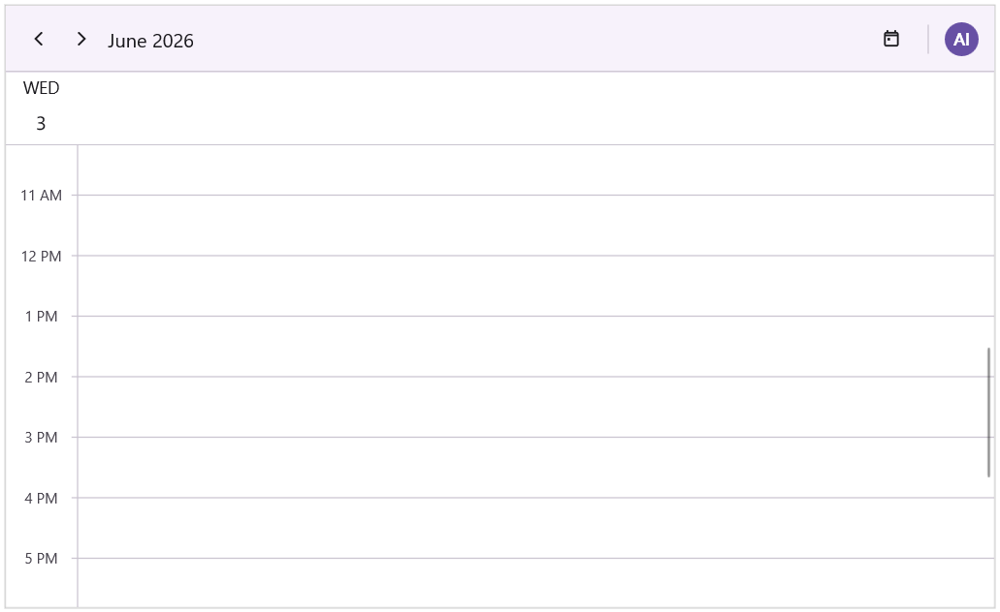

## Assist View

The default appearance of the assist view can be customized by setting the [AssistViewHeight](https://help.syncfusion.com/cr/maui/Syncfusion.Maui.SmartScheduler.SchedulerAssistViewSettings.html#Syncfusion_Maui_SmartScheduler_SchedulerAssistViewSettings_AssistViewHeight), [AssistViewWidth](https://help.syncfusion.com/cr/maui/Syncfusion.Maui.SmartScheduler.SchedulerAssistViewSettings.html#Syncfusion_Maui_SmartScheduler_SchedulerAssistViewSettings_AssistViewWidth), [AssistViewHeaderText](https://help.syncfusion.com/cr/maui/Syncfusion.Maui.SmartScheduler.SchedulerAssistViewSettings.html#Syncfusion_Maui_SmartScheduler_SchedulerAssistViewSettings_AssistViewHeaderText), [Placeholder](https://help.syncfusion.com/cr/maui/Syncfusion.Maui.SmartScheduler.SchedulerAssistViewSettings.html#Syncfusion_Maui_SmartScheduler_SchedulerAssistViewSettings_Placeholder), [Prompt](https://help.syncfusion.com/cr/maui/Syncfusion.Maui.SmartScheduler.SchedulerAssistViewSettings.html#Syncfusion_Maui_SmartScheduler_SchedulerAssistViewSettings_Prompt), [SuggestedPrompts](https://help.syncfusion.com/cr/maui/Syncfusion.Maui.SmartScheduler.SchedulerAssistViewSettings.html#Syncfusion_Maui_SmartScheduler_SchedulerAssistViewSettings_SuggestedPrompts) and [ShowAssistViewBanner](https://help.syncfusion.com/cr/maui/Syncfusion.Maui.SmartScheduler.SchedulerAssistViewSettings.html#Syncfusion_Maui_SmartScheduler_SchedulerAssistViewSettings_ShowAssistViewBanner) properties of [SfSmartScheduler](https://help.syncfusion.com/cr/maui/Syncfusion.Maui.SmartScheduler.html) control.

### Assist view height

The assist view height can be customized by using the [AssistViewHeight](https://help.syncfusion.com/cr/maui/Syncfusion.Maui.SmartScheduler.SchedulerAssistViewSettings.html#Syncfusion_Maui_SmartScheduler_SchedulerAssistViewSettings_AssistViewHeight) property of the [AssistViewSettings](https://help.syncfusion.com/cr/maui/Syncfusion.Maui.SmartScheduler.SchedulerAssistViewSettings.html).




<ContentPage   
    . . .
    xmlns:smartScheduler="clr-namespace:Syncfusion.Maui.SmartScheduler;assembly=Syncfusion.Maui.SmartScheduler">
    <smartScheduler:SfSmartScheduler  x:Name="smartScheduler">
        <smartScheduler:SfSmartScheduler.AssistViewSettings>
            <smartScheduler:SchedulerAssistViewSettings AssistViewHeight="420"/>
        </smartScheduler:SfSmartScheduler.AssistViewSettings>
    </smartScheduler:SfSmartScheduler>
</ContentPage>




using Syncfusion.Maui.SmartScheduler;

. . .
SfSmartScheduler smartScheduler = new SfSmartScheduler();
smartScheduler.AssistViewSettings.AssistViewHeight = 420;
this.Content = smartScheduler;




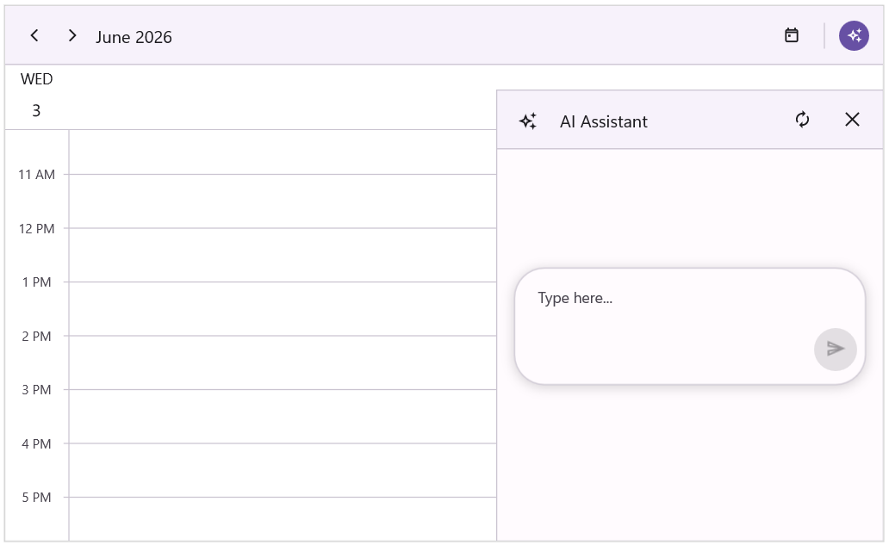

### Assist view width

The assist view width can be customized by using the [AssistViewWidth](https://help.syncfusion.com/cr/maui/Syncfusion.Maui.SmartScheduler.SchedulerAssistViewSettings.html#Syncfusion_Maui_SmartScheduler_SchedulerAssistViewSettings_AssistViewWidth) property of the [AssistViewSettings](https://help.syncfusion.com/cr/maui/Syncfusion.Maui.SmartScheduler.SchedulerAssistViewSettings.html).




<ContentPage   
    . . .
    xmlns:smartScheduler="clr-namespace:Syncfusion.Maui.SmartScheduler;assembly=Syncfusion.Maui.SmartScheduler">
    <smartScheduler:SfSmartScheduler  x:Name="smartScheduler">
        <smartScheduler:SfSmartScheduler.AssistViewSettings>
            <smartScheduler:SchedulerAssistViewSettings AssistViewWidth="500"/>
        </smartScheduler:SfSmartScheduler.AssistViewSettings>
    </smartScheduler:SfSmartScheduler>
</ContentPage>




using Syncfusion.Maui.SmartScheduler;

. . .
SfSmartScheduler smartScheduler = new SfSmartScheduler();
smartScheduler.AssistViewSettings.AssistViewWidth = 500;
this.Content = smartScheduler;




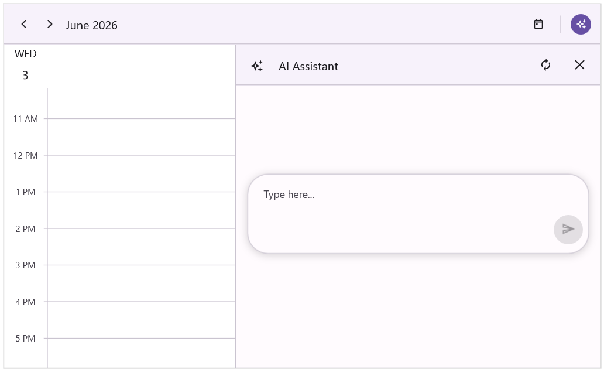

### Assist view header text

The assist view header text can be customized by using the [AssistViewHeaderText](https://help.syncfusion.com/cr/maui/Syncfusion.Maui.SmartScheduler.SchedulerAssistViewSettings.html#Syncfusion_Maui_SmartScheduler_SchedulerAssistViewSettings_AssistViewHeaderText) property of the [AssistViewSettings](https://help.syncfusion.com/cr/maui/Syncfusion.Maui.SmartScheduler.SchedulerAssistViewSettings.html).




<ContentPage   
    . . .
    xmlns:smartScheduler="clr-namespace:Syncfusion.Maui.SmartScheduler;assembly=Syncfusion.Maui.SmartScheduler">
    <smartScheduler:SfSmartScheduler  x:Name="smartScheduler">
        <smartScheduler:SfSmartScheduler.AssistViewSettings>
            <smartScheduler:SchedulerAssistViewSettings AssistViewHeaderText="Smart Scheduler"/>
        </smartScheduler:SfSmartScheduler.AssistViewSettings>
    </smartScheduler:SfSmartScheduler>
</ContentPage>




using Syncfusion.Maui.SmartScheduler;

. . .
SfSmartScheduler smartScheduler = new SfSmartScheduler();
smartScheduler.AssistViewSettings.AssistViewHeaderText = "Smart Scheduler";
this.Content = smartScheduler;




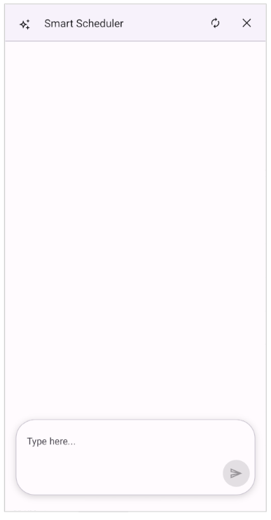

### Placeholder

The assist view placeholder text can be customized by using the [Placeholder](https://help.syncfusion.com/cr/maui/Syncfusion.Maui.SmartScheduler.SchedulerAssistViewSettings.html#Syncfusion_Maui_SmartScheduler_SchedulerAssistViewSettings_Placeholder) property of the [AssistViewSettings](https://help.syncfusion.com/cr/maui/Syncfusion.Maui.SmartScheduler.SchedulerAssistViewSettings.html).




<ContentPage   
    . . .
    xmlns:smartScheduler="clr-namespace:Syncfusion.Maui.SmartScheduler;assembly=Syncfusion.Maui.SmartScheduler">
    <smartScheduler:SfSmartScheduler  x:Name="smartScheduler">
        <smartScheduler:SfSmartScheduler.AssistViewSettings>
            <smartScheduler:SchedulerAssistViewSettings Placeholder="Enter your message..."/>
        </smartScheduler:SfSmartScheduler.AssistViewSettings>
    </smartScheduler:SfSmartScheduler>
</ContentPage>




using Syncfusion.Maui.SmartScheduler;

. . .
SfSmartScheduler smartScheduler = new SfSmartScheduler();
smartScheduler.AssistViewSettings.Placeholder = "Enter your message...";
this.Content = smartScheduler;




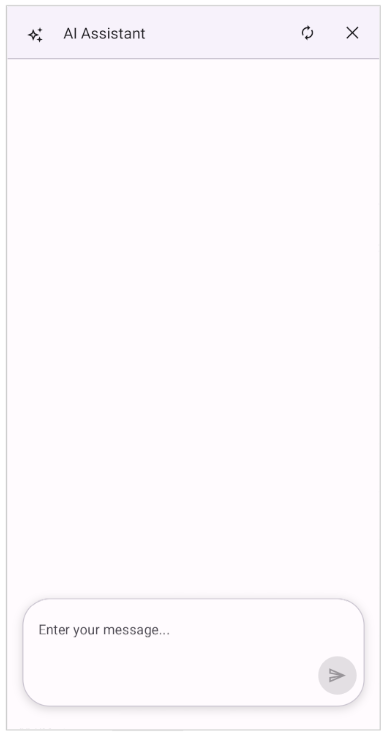

### Prompt

The assist view prompt text can be customized by using the [Prompt](https://help.syncfusion.com/cr/maui/Syncfusion.Maui.SmartScheduler.SchedulerAssistViewSettings.html#Syncfusion_Maui_SmartScheduler_SchedulerAssistViewSettings_Prompt) property of the [AssistViewSettings](https://help.syncfusion.com/cr/maui/Syncfusion.Maui.SmartScheduler.SchedulerAssistViewSettings.html). By default, the [Prompt](https://help.syncfusion.com/cr/maui/Syncfusion.Maui.SmartScheduler.SchedulerAssistViewSettings.html#Syncfusion_Maui_SmartScheduler_SchedulerAssistViewSettings_Prompt) property is set to empty.




<ContentPage   
    . . .
    xmlns:smartScheduler="clr-namespace:Syncfusion.Maui.SmartScheduler;assembly=Syncfusion.Maui.SmartScheduler">
    <smartScheduler:SfSmartScheduler  x:Name="smartScheduler">
        <smartScheduler:SfSmartScheduler.AssistViewSettings>
            <smartScheduler:SchedulerAssistViewSettings Prompt="Find 30-minute slots this week"/>
        </smartScheduler:SfSmartScheduler.AssistViewSettings>
    </smartScheduler:SfSmartScheduler>
</ContentPage>




using Syncfusion.Maui.SmartScheduler;

. . .
SfSmartScheduler smartScheduler = new SfSmartScheduler();
smartScheduler.AssistViewSettings.Prompt = "Find 30-minute slots this week";
this.Content = smartScheduler;




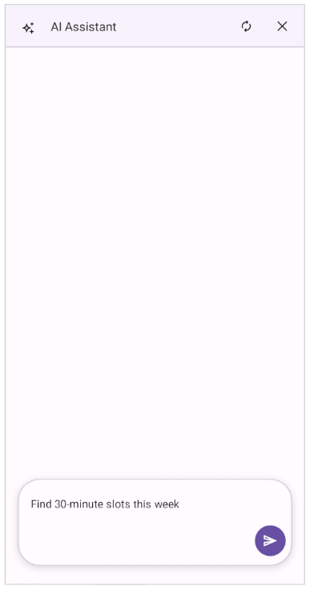

### Suggested Prompts

The assist view suggested prompts can be customized by using the [SuggestedPrompts](https://help.syncfusion.com/cr/maui/Syncfusion.Maui.SmartScheduler.SchedulerAssistViewSettings.html#Syncfusion_Maui_SmartScheduler_SchedulerAssistViewSettings_SuggestedPrompts) property of the [AssistViewSettings](https://help.syncfusion.com/cr/maui/Syncfusion.Maui.SmartScheduler.SchedulerAssistViewSettings.html). By default, the [SuggestedPrompts](https://help.syncfusion.com/cr/maui/Syncfusion.Maui.SmartScheduler.SchedulerAssistViewSettings.html#Syncfusion_Maui_SmartScheduler_SchedulerAssistViewSettings_SuggestedPrompts) property is set to null.




<ContentPage   
    . . .
    xmlns:smartScheduler="clr-namespace:Syncfusion.Maui.SmartScheduler;assembly=Syncfusion.Maui.SmartScheduler">
    <ContentPage.BindingContext>
        <local:ViewModel/>
    </ContentPage.BindingContext>

    <smartScheduler:SfSmartScheduler x:Name="smartScheduler">
        <smartScheduler:SfSmartScheduler.AssistViewSettings >
            <smartScheduler:SchedulerAssistViewSettings SuggestedPrompts="{Binding SuggestedPrompts}"/>
        </smartScheduler:SfSmartScheduler.AssistViewSettings>
    </smartScheduler:SfSmartScheduler>
</ContentPage>




using Syncfusion.Maui.SmartScheduler;

. . .
 SfSmartScheduler smartScheduler = new SfSmartScheduler();
 smartScheduler.AssistViewSettings.ShowAssistViewBanner = true;
 smartScheduler.AssistViewSettings.SuggestedPrompts = new List<string>
 {
    "Summarize today's appointments",
    "Find today's free timeslots",
    "Conflict detection"
 };
 this.Content = smartScheduler;




public class ViewModel
{
    private List<string> suggestedPrompts;
    
    public List<string> SuggestedPrompts
    {
        get { return suggestedPrompts; }
        set { suggestedPrompts = value; }
    }

    public ViewModel()
    {
        this.suggestedPrompts = new List<string>()
        {
            "Summarize today's appointments",
            "Find today's free timeslots",
            "Conflict detection"
        };
    }
}




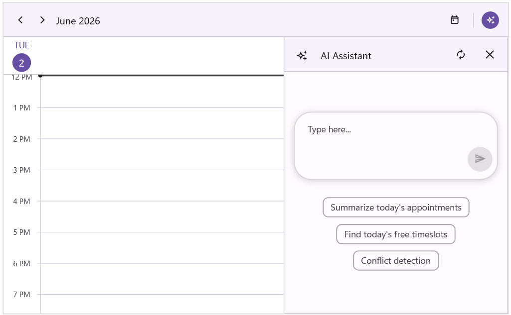

### Show Assist View Banner

The assist view banner is a promotional message displayed when the assist view opens. Control its visibility using the [ShowAssistViewBanner](https://help.syncfusion.com/cr/maui/Syncfusion.Maui.SmartScheduler.SchedulerAssistViewSettings.html#Syncfusion_Maui_SmartScheduler_SchedulerAssistViewSettings_ShowAssistViewBanner) property of the [AssistViewSettings](https://help.syncfusion.com/cr/maui/Syncfusion.Maui.SmartScheduler.SchedulerAssistViewSettings.html). By default, this property is set to `false`.




<ContentPage   
    . . .
    xmlns:smartScheduler="clr-namespace:Syncfusion.Maui.SmartScheduler;assembly=Syncfusion.Maui.SmartScheduler">
    <smartScheduler:SfSmartScheduler  x:Name="smartScheduler">
        <smartScheduler:SfSmartScheduler.AssistViewSettings>
            <smartScheduler:SchedulerAssistViewSettings ShowAssistViewBanner="True"/>
        </smartScheduler:SfSmartScheduler.AssistViewSettings>
    </smartScheduler:SfSmartScheduler>
</ContentPage>




using Syncfusion.Maui.SmartScheduler;

. . .
this.smartScheduler = new SfSmartScheduler();
this.smartScheduler.AssistViewSettings.ShowAssistViewBanner = true;
this.Content = smartScheduler;




### Voice input

The voice input functionality can be enabled by using the [EnableVoiceInput](https://help.syncfusion.com/cr/maui/Syncfusion.Maui.SmartScheduler.SchedulerAssistViewSettings.html#Syncfusion_Maui_SmartScheduler_SchedulerAssistViewSettings_EnableVoiceInput) property of the [AssistViewSettings](https://help.syncfusion.com/cr/maui/Syncfusion.Maui.SmartScheduler.SchedulerAssistViewSettings.html). When enabled, users can interact with the assist view using voice commands instead of typing requests manually. By default, the `EnableVoiceInput` property is set to `false`.




<ContentPage   
    . . .
    xmlns:smartScheduler="clr-namespace:Syncfusion.Maui.SmartScheduler;assembly=Syncfusion.Maui.SmartScheduler">
    <smartScheduler:SfSmartScheduler  x:Name="smartScheduler">
        <smartScheduler:SfSmartScheduler.AssistViewSettings>
            <smartScheduler:SchedulerAssistViewSettings EnableVoiceInput="True"/>
        </smartScheduler:SfSmartScheduler.AssistViewSettings>
    </smartScheduler:SfSmartScheduler>
</ContentPage>




using Syncfusion.Maui.SmartScheduler;

. . .
this.smartScheduler = new SfSmartScheduler();
this.smartScheduler.AssistViewSettings.EnableVoiceInput = true;
this.Content = smartScheduler;




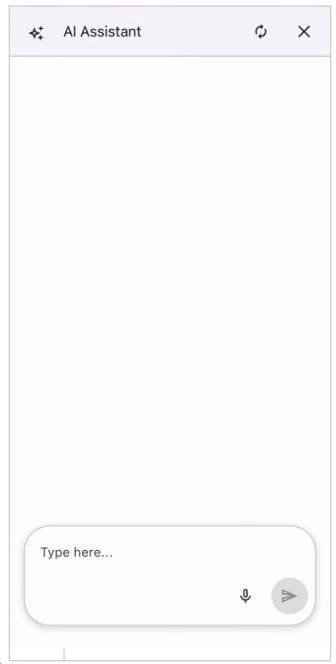

## Custom appointment and resource mapping

The [SfSmartScheduler](https://help.syncfusion.com/cr/maui/Syncfusion.Maui.SmartScheduler.html) works with your own business objects. You do not have to convert them to `SchedulerAppointment` or `SchedulerResource`. Map your model properties to the scheduler fields, and the assist view creates, edits, and deletes appointments on your objects directly.

### Custom appointment mapping

Map the properties of your data model to the scheduler appointment fields using the [AppointmentMapping](https://help.syncfusion.com/cr/maui/Syncfusion.Maui.Scheduler.SchedulerAppointmentMapping.html) property. The `AppointmentsSource` must be a collection of your custom objects.




public class Meeting
{
    public string EventName { get; set; } = string.Empty;
    public DateTime From { get; set; }
    public DateTime To { get; set; }
    public bool IsAllDay { get; set; }
    public string Notes { get; set; } = string.Empty;
    public Brush Background { get; set; } = Brush.Red;
    public ObservableCollection<object> Resources { get; set; } = new();
}




<ContentPage   
    . . .
    xmlns:scheduler="clr-namespace:Syncfusion.Maui.Scheduler;assembly=Syncfusion.Maui.Scheduler"
    xmlns:smartScheduler="clr-namespace:Syncfusion.Maui.SmartScheduler;assembly=Syncfusion.Maui.SmartScheduler">
    <smartScheduler:SfSmartScheduler x:Name="smartScheduler"
                                     EnableAssistButton="True"
                                     AppointmentsSource="{Binding Meetings}">
        <smartScheduler:SfSmartScheduler.AppointmentMapping>
            <scheduler:SchedulerAppointmentMapping
                Subject="EventName"
                StartTime="From"
                EndTime="To"
                IsAllDay="IsAllDay"
                Notes="Notes"
                Background="Background"
                ResourceIds="Resources" />
        </smartScheduler:SfSmartScheduler.AppointmentMapping>
    </smartScheduler:SfSmartScheduler>
</ContentPage>




using Syncfusion.Maui.Scheduler;
using Syncfusion.Maui.SmartScheduler;

. . .
this.smartScheduler.AppointmentsSource = meetings;
this.smartScheduler.AppointmentMapping = new SchedulerAppointmentMapping
{
    Subject = nameof(Meeting.EventName),
    StartTime = nameof(Meeting.From),
    EndTime = nameof(Meeting.To),
    IsAllDay = nameof(Meeting.IsAllDay),
    Notes = nameof(Meeting.Notes),
    Background = nameof(Meeting.Background),
    ResourceIds = nameof(Meeting.Resources),
};




When you ask the assist view to create, reschedule, or delete a meeting, it performs the following actions:

- Creates a new `Meeting` instance and fills the mapped properties.
- Updates the mapped properties on the existing `Meeting` when it is edited.
- Removes the `Meeting` from the `AppointmentsSource` when it is deleted.

### Custom resource mapping

Map your resource model to the scheduler resource fields using the [Mapping](https://help.syncfusion.com/cr/maui/Syncfusion.Maui.Scheduler.SchedulerResourceView.html) property of the `ResourceView`.




public class Employee
{
    public int Id { get; set; }
    public string Name { get; set; } = string.Empty;
    public Brush Background { get; set; } = Brush.Blue;
    public Brush Foreground { get; set; } = Brush.White;
}




<ContentPage   
    . . .
    xmlns:scheduler="clr-namespace:Syncfusion.Maui.Scheduler;assembly=Syncfusion.Maui.Scheduler"
    xmlns:smartScheduler="clr-namespace:Syncfusion.Maui.SmartScheduler;assembly=Syncfusion.Maui.SmartScheduler">
    <smartScheduler:SfSmartScheduler x:Name="smartScheduler">
        <smartScheduler:SfSmartScheduler.ResourceView>
            <scheduler:SchedulerResourceView Resources="{Binding Employees}">
                <scheduler:SchedulerResourceView.Mapping>
                    <scheduler:SchedulerResourceMapping Id="Id"
                                                        Name="Name"
                                                        Background="Background"
                                                        Foreground="Foreground" />
                </scheduler:SchedulerResourceView.Mapping>
            </scheduler:SchedulerResourceView>
        </smartScheduler:SfSmartScheduler.ResourceView>
    </smartScheduler:SfSmartScheduler>
</ContentPage>




using Syncfusion.Maui.Scheduler;
using Syncfusion.Maui.SmartScheduler;

. . .
this.smartScheduler.ResourceView = new SchedulerResourceView
{
    Resources = employees,
    Mapping = new SchedulerResourceMapping
    {
        Id = nameof(Employee.Id),
        Name = nameof(Employee.Name),
        Background = nameof(Employee.Background),
        Foreground = nameof(Employee.Foreground),
    },
};




The assist view finds resources by their mapped `Name`, for example, *"Schedule a meeting with Alice."* It stores the matching resource `Id` in the mapped `ResourceIds` property of the appointment.

### Supported mapping properties

| Mapping class | Property | Description |
|---|---|---|
| `SchedulerAppointmentMapping` | `Subject` | Title of the appointment. |
| | `StartTime` / `EndTime` | Start and end date-time of the appointment. |
| | `IsAllDay` | Indicates whether the appointment is an all-day appointment. |
| | `Notes` | Description or notes of the appointment. |
| | `Background` | Background color of the appointment. |
| | `ResourceIds` | Collection of assigned resource IDs. |
| | `Reminders` | Reminders collection of the appointment. |
| `SchedulerResourceMapping` | `Id` | Unique ID of the resource. |
| | `Name` | Display name of the resource. The assist view uses it to match resources. |
| | `Background` / `Foreground` | Background and foreground colors of the resource. |

N>
- Property names in the mapping must match the model property names exactly.
- Without a mapping, the `AppointmentsSource` is a collection of `SchedulerAppointment` and works as usual.

## Template Customization

The [SfSmartScheduler](https://help.syncfusion.com/cr/maui/Syncfusion.Maui.SmartScheduler.html) facilitates the customization of both header and banner templates according to specific requirements. This feature enhances flexibility and provides a higher degree of control over the display of assist view.

### Customize assist view header appearance using DataTemplate

The assist view header appearance can be customized by using the [AssistViewHeaderTemplate](https://help.syncfusion.com/cr/maui/Syncfusion.Maui.SmartScheduler.SchedulerAssistViewSettings.html#Syncfusion_Maui_SmartScheduler_SchedulerAssistViewSettings_AssistViewHeaderTemplate) property of the [AssistViewSettings](https://help.syncfusion.com/cr/maui/Syncfusion.Maui.SmartScheduler.SchedulerAssistViewSettings.html).




<ContentPage   
    . . .
    xmlns:smartScheduler="clr-namespace:Syncfusion.Maui.SmartScheduler;assembly=Syncfusion.Maui.SmartScheduler">
    <smartScheduler:SfSmartScheduler x:Name="smartScheduler">
        <smartScheduler:SfSmartScheduler.AssistViewSettings>
            <smartScheduler:SchedulerAssistViewSettings>
                <smartScheduler:SchedulerAssistViewSettings.AssistViewHeaderTemplate>
                    <DataTemplate>
                        <Grid BackgroundColor="LightYellow"
                            ColumnDefinitions="40,*,40,40">
                            <Label Text="✦"
                                FontSize="20"
                                VerticalTextAlignment="Center"
                                HorizontalTextAlignment="Center"
                                Grid.Column="0" />
                            <Label Text="Smart Scheduler"
                                FontAttributes="Bold"
                                FontSize="16"
                                VerticalTextAlignment="Center"
                                HorizontalTextAlignment="Start"
                                Grid.Column="1" />
                            <Label Text="⟳"
                                FontSize="20"
                                VerticalTextAlignment="Center"
                                HorizontalTextAlignment="Center"
                                Grid.Column="2" />
                            <Label Text="✕"
                                FontSize="20"
                                VerticalTextAlignment="Center"
                                HorizontalTextAlignment="Center"
                                Grid.Column="3" />
                        </Grid>
                    </DataTemplate>
                </smartScheduler:SchedulerAssistViewSettings.AssistViewHeaderTemplate>
            </smartScheduler:SchedulerAssistViewSettings>
        </smartScheduler:SfSmartScheduler.AssistViewSettings>
    </smartScheduler:SfSmartScheduler>
</ContentPage>




using Syncfusion.Maui.SmartScheduler;

. . .
SfSmartScheduler smartScheduler = new SfSmartScheduler();
smartScheduler.AssistViewSettings = new SchedulerAssistViewSettings();
smartScheduler.AssistViewSettings.AssistViewHeaderTemplate = new DataTemplate(() =>
{
    var grid = new Grid
    {
        BackgroundColor = Colors.LightYellow,
        ColumnDefinitions =
        {
            new ColumnDefinition { Width = 40 },
            new ColumnDefinition { Width = GridLength.Star },
            new ColumnDefinition { Width = 40 },
            new ColumnDefinition { Width = 40 }
        }
    };

    var symbol = new Label
    {
        Text = "✦",
        FontSize = 20,
        VerticalTextAlignment = TextAlignment.Center,
        HorizontalTextAlignment = TextAlignment.Center
    };
    grid.Children.Add(symbol);
    Grid.SetColumn(symbol, 0);

    var title = new Label
    {
        Text = "Smart Scheduler",
        FontAttributes = FontAttributes.Bold,
        FontSize = 16,
        VerticalTextAlignment = TextAlignment.Center,
        HorizontalTextAlignment = TextAlignment.Start
    };
    grid.Children.Add(title);
    Grid.SetColumn(title, 1);

    var reset = new Label
    {
        Text = "⟳",
        FontSize = 20,
        VerticalTextAlignment = TextAlignment.Center,
        HorizontalTextAlignment = TextAlignment.Center
    };
    grid.Children.Add(reset);
    Grid.SetColumn(reset, 2);

    var close = new Label
    {
        Text = "✕",
        FontSize = 20,
        VerticalTextAlignment = TextAlignment.Center,
        HorizontalTextAlignment = TextAlignment.Center
    };
    grid.Children.Add(close);
    Grid.SetColumn(close, 3);

    return grid;
});
this.Content = smartScheduler;




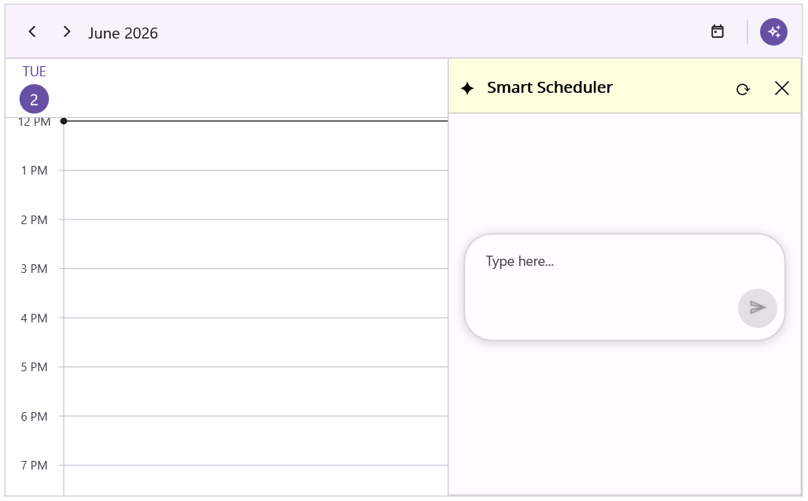

### Customize assist view banner appearance using DataTemplate

The assist view banner appearance can be customized by using the [AssistViewBannerTemplate](https://help.syncfusion.com/cr/maui/Syncfusion.Maui.SmartScheduler.SchedulerAssistViewSettings.html#Syncfusion_Maui_SmartScheduler_SchedulerAssistViewSettings_AssistViewBannerTemplate) property of the [AssistViewSettings](https://help.syncfusion.com/cr/maui/Syncfusion.Maui.SmartScheduler.SchedulerAssistViewSettings.html).




<ContentPage   
    . . .
    xmlns:smartScheduler="clr-namespace:Syncfusion.Maui.SmartScheduler;assembly=Syncfusion.Maui.SmartScheduler">
    <smartScheduler:SfSmartScheduler x:Name="smartScheduler">
        <smartScheduler:SfSmartScheduler.AssistViewSettings>
            <smartScheduler:SchedulerAssistViewSettings ShowAssistViewBanner="True">
                <smartScheduler:SchedulerAssistViewSettings.AssistViewBannerTemplate>
                    <DataTemplate>
                        <Grid Padding="16"
                            Margin="0,40,0,0"
                            BackgroundColor="#E9EEFF"
                            HorizontalOptions="Center"
                            VerticalOptions="Start">
                            <Label Text="Hi ! I’m your personalized assistant.&#10;How can I help you ?"
                                    HorizontalTextAlignment="Center"
                                    VerticalTextAlignment="Center"
                                    TextColor="#1C1B1F"
                                    FontSize="16"
                                    Padding="10" />
                        </Grid>
                    </DataTemplate>
                </smartScheduler:SchedulerAssistViewSettings.AssistViewBannerTemplate>
            </smartScheduler:SchedulerAssistViewSettings>
        </smartScheduler:SfSmartScheduler.AssistViewSettings>
    </smartScheduler:SfSmartScheduler>
</ContentPage>




using Syncfusion.Maui.SmartScheduler;

. . .
SfSmartScheduler smartScheduler = new SfSmartScheduler();
smartScheduler.AssistViewSettings = new SchedulerAssistViewSettings();
smartScheduler.AssistViewSettings.ShowAssistViewBanner = true;
smartScheduler.AssistViewSettings.AssistViewBannerTemplate = new DataTemplate(() =>
{
    var grid = new Grid
    {
        Padding = new Thickness(16),
        Margin = new Thickness(0, 40, 0, 0),
        BackgroundColor = Color.FromArgb("#E9EEFF"),
        HorizontalOptions = LayoutOptions.Center,
        VerticalOptions = LayoutOptions.Start
    };

    var label = new Label
    {
        Text = "Hi! I’m your personalized assistant.\nHow can I help you?",
        HorizontalTextAlignment = TextAlignment.Center,
        VerticalTextAlignment = TextAlignment.Center,
        TextColor = Color.FromArgb("#1C1B1F"),
        FontSize = 16,
        Padding = new Thickness(10),
        FontAttributes = FontAttributes.None
    };
    
    grid.Children.Add(label);
    return grid;
});
this.Content = smartScheduler;




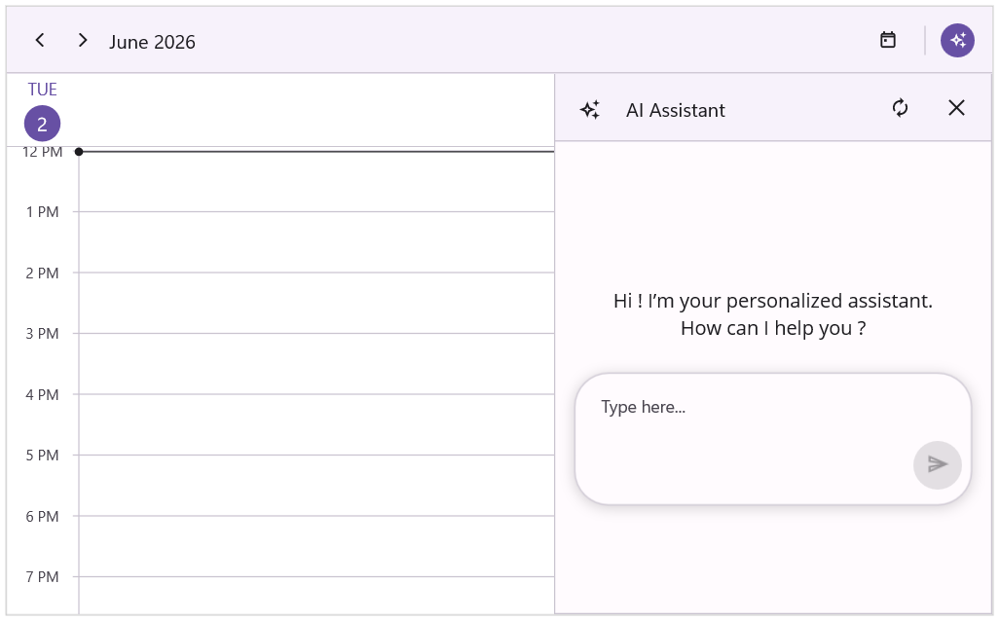

## Smart navigation

The Smart navigation capability of [SfSmartScheduler](https://help.syncfusion.com/cr/maui/Syncfusion.Maui.SmartScheduler.html) allows users to move through the Scheduler using natural language. Requests such as jumping to a date, opening a range, or switching the active view are interpreted by the assist panel and applied to the schedule without touching the header controls.

### Date navigation

It allows users to navigate to a specific date or range using natural language in the assist panel. The Scheduler interprets the request and updates the visible date accordingly.

The following examples illustrate common date navigation requests:

- *"Show me next Friday."*
- *"Move to the week of June 15."*
- *"Take me to July 4, 2026."*

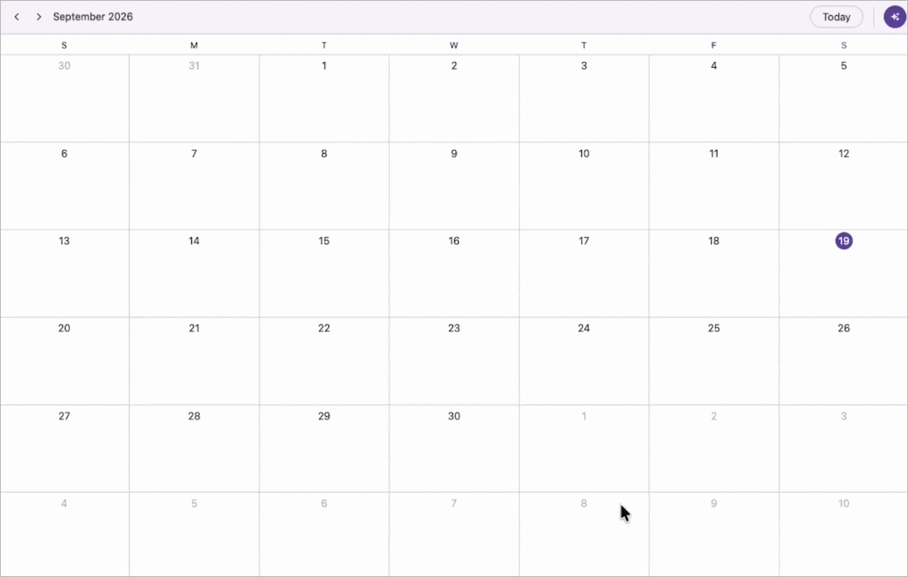

### View switching

It allows users to switch the active view of the Scheduler using natural language in the assist panel. Supported views include Day, Week, Work Week, Month, Timeline, and Agenda.

The following examples illustrate common view switching requests:

- *"Switch to month view."*
- *"Go to timeline week view."*
- *"Show me an agenda of today's appointments."*

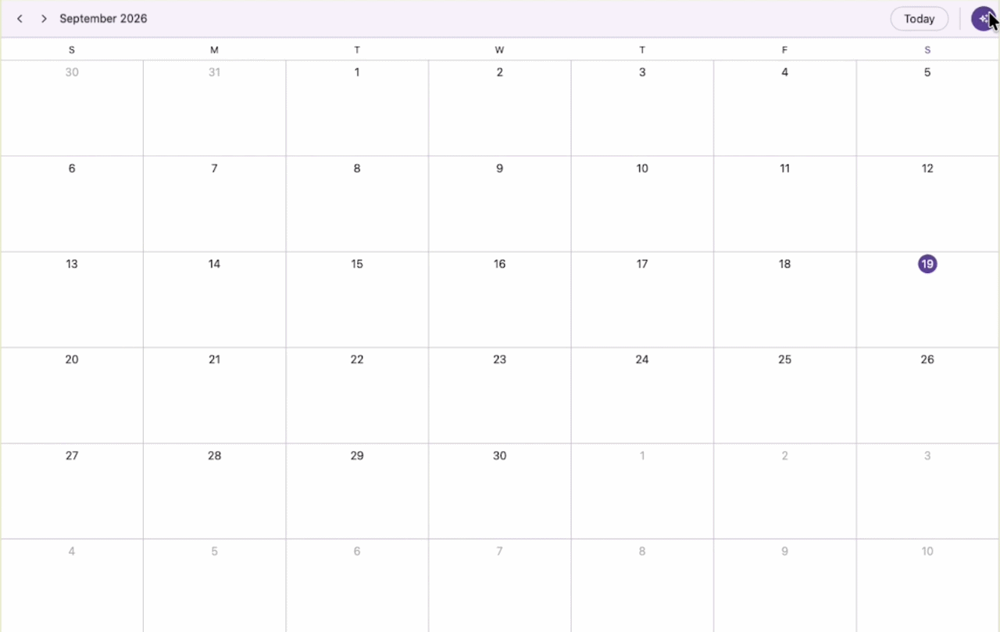

N>
View switching honors the [AllowedViews](https://help.syncfusion.com/cr/maui/Syncfusion.Maui.SmartScheduler.SfSmartScheduler.html#Syncfusion_Maui_SmartScheduler_SfSmartScheduler_AllowedViews) property of [`SfSmartScheduler`](https://help.syncfusion.com/cr/maui/Syncfusion.Maui.SmartScheduler.html). The assist panel restricts its view-switching to only the views listed in that property.

## Smart rescheduling

The Smart rescheduling capability allows users to reschedule multiple matching appointments using a single natural language request in the assist panel.

### Reschedule multiple appointments

Users can reschedule all matching appointments at once by specifying terms such as *all* or *every* in the natural language request. The Smart Scheduler identifies the matching appointments and updates them based on the requested date or time.

The following examples illustrate common smart rescheduling requests:

- *"Reschedule all of Sarah's meetings to 3 PM."*
- *"Move every project review meeting to tomorrow."*
- *"Reschedule all of today's appointments with Zoey Addison to tomorrow."*

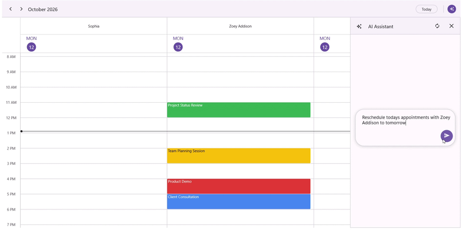
