# Getting Started with Windows Forms Scheduler

This topic explains how to create a basic Windows Forms application that uses [ScheduleControl](https://www.syncfusion.com/scheduler-sdk/winforms-scheduler) to display and manage appointments.

## Assembly deployment

Before using the control in a Windows Forms application, add the required assemblies. You can refer to the [control dependencies](https://help.syncfusion.com/windowsforms/control-dependencies#schedule) section for the list of assemblies, or use the [NuGet package](https://help.syncfusion.com/windowsforms/installation/install-nuget-packages) to add the references automatically.

## Building a basic scheduler application

This walkthrough demonstrates how to build a basic WinForms application that uses the [Windows Forms Scheduler](https://www.syncfusion.com/scheduler-sdk/winforms-scheduler) control to display and manage appointments.

### Creating the project

Create a new Windows Forms project in Visual Studio.

### Adding the control through the designer

1. Drag the Schedule control from the Toolbox onto the designer surface. Visual Studio automatically adds the required assembly references to the project.

   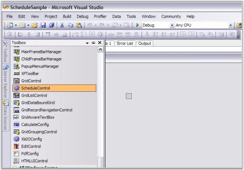

    The ScheduleControl appears on the design surface. Use the Appearance property in the Properties window to customize the visual settings of the control.

   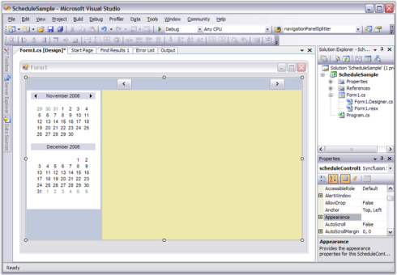
	
### Adding the control programmatically

To add the Scheduler control programmatically, follow these steps.

1. Add the following required assembly references to the project:

    * Syncfusion.Grid.Base.
    * Syncfusion.Grid.Windows.
    * Syncfusion.Schedule.Base.
    * Syncfusion.Schedule.Windows.
    * Syncfusion.Shared.Base.
    * Syncfusion.Tools.Windows.

2. Create the ScheduleControl instance in the application form constructor.




using Syncfusion.Windows.Forms.Schedule;

namespace WindowsFormsApplication1
{
    public partial class Form1 : Form
    {
        private readonly ScheduleControl scheduleControl;

        public Form1()
        {
            InitializeComponent();
            scheduleControl = new ScheduleControl();
            scheduleControl.Location = new Point(82, 12);
            scheduleControl.Size = new Size(350, 360);
            this.Controls.Add(scheduleControl);
        }
    }
}



Imports Syncfusion.Windows.Forms.Schedule

Namespace WindowsFormsApplication1
    Public Partial Class Form1
        Private ReadOnly scheduleControl As ScheduleControl
        Public Sub New()
            InitializeComponent()
            scheduleControl = New ScheduleControl()
            scheduleControl.Location = New Point(82, 12)
            scheduleControl.Size = New Size(350, 360)
            Me.Controls.Add(scheduleControl)
        End Sub
    End Class
End Namespace



{{ codesnippet1 | OrderList_Indent_Level_1 }}

### Binding data to the ScheduleControl

The ScheduleControl displays appointment data through a data provider. To load appointment data, assign a provider to the DataSource property.

### Connecting sample data with SimpleScheduleDataProvider

The sample provider included with the Scheduler sample provides a quick way to load appointments. Use the following steps to connect it to the control.

1. Add the SimpleScheduleDataProvider.cs file to your project, or add SimpleScheduleDataProvider.vb if you are using VB.NET.

This file contains the classes that implement the ScheduleControl data interfaces and manage the appointment data displayed in the Scheduler. These interfaces are discussed later in this User Guide.

Use the implementation provided in the `SimpleScheduleDataProvider.cs` file. It ships with the [WinForms Scheduler sample](https://github.com/syncfusion/winforms-demos/tree/master/schedulecontrol/Scheduler%20Demo/CS). Add it to your project from Solution Explorer.

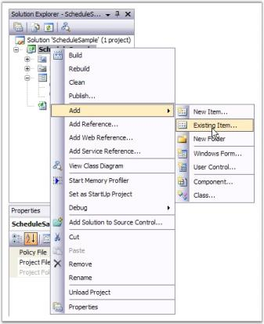

2. You can also find the `SimpleScheduleDataProvider.cs` file in the [Syncfusion_build_installed_location]\Syncfusion\Essential Studio\&lt;Product_version&gt;\Windows\Schedule.Windows\Samples\&lt;Framework_version&gt;\ScheduleSample\CS_ folder. Copy the file into your project from there.

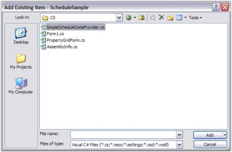

3. After adding the `SimpleScheduleDataProvider.cs` file, update Form.cs to bind the provider to the ScheduleControl.

Add a using statement so that you can refer to the class names in `SimpleScheduleDataProvider.cs` without repeating the namespace. In `Form_Load`, create the provider, initialize the MasterList, set the file name, choose the initial ScheduleViewType, and assign the provider to DataSource. Copy this code to Form1.cs.



using Syncfusion.Windows.Forms.Schedule;

namespace GridScheduleSample
{
    public partial class Form1 : Form
    {
        private readonly ScheduleControl scheduleControl = new();

	 	public Form1()
	 	{
			InitializeComponent();
            scheduleControl = new ScheduleControl();
            this.Controls.Add(scheduleControl);
            Load += Form1_Load;
		}

		private void Form1_Load(object sender, EventArgs e)
		{
			SimpleScheduleDataProvider data = new SimpleScheduleDataProvider();
			data.MasterList = new SimpleScheduleAppointmentList();
			data.FileName = "default.schedule";
			this.scheduleControl.ScheduleType = ScheduleViewType.Month;
			this.scheduleControl.DataSource = data;
		}
	 }
}


Imports Syncfusion.Windows.Forms.Schedule

Namespace GridScheduleSample

    Public Partial Class Form1

        Private ReadOnly scheduleControl As ScheduleControl

        Public Sub New()
            InitializeComponent()
            scheduleControl = New ScheduleControl()
            Me.Controls.Add(scheduleControl)
            AddHandler Load, AddressOf Form1_Load
        End Sub

        Private Sub Form1_Load(ByVal sender As Object, ByVal e As EventArgs)
            Dim data As SimpleScheduleDataProvider = New SimpleScheduleDataProvider()
            data.MasterList = New SimpleScheduleAppointmentList()
            data.FileName = "default.schedule"
            Me.scheduleControl.ScheduleType = ScheduleViewType.Month
            Me.scheduleControl.DataSource = data
        End Sub
    End Class
End Namespace



4. Press `F5` to build and run the project.

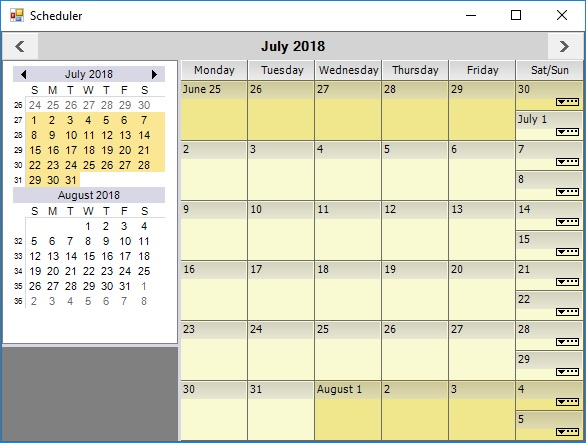
 
## Changing views

The WinForms Scheduler supports the following schedule view types:

* Month
* Day
* Week
* WorkWeek
* CustomWeek

To switch from Month view to Day view, right-click the ScheduleGrid area and select a day from the context menu.

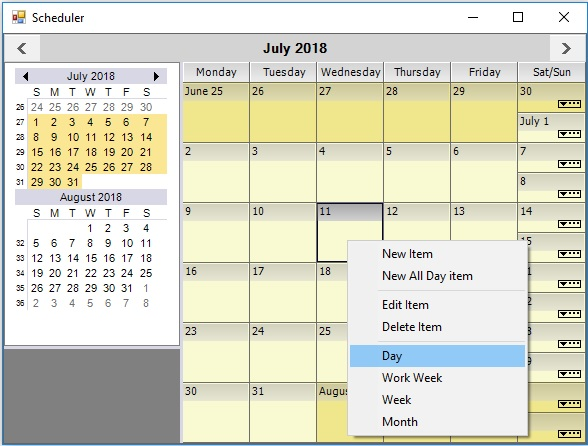
	
You can use the same context menu to switch to any of the other available schedule views.

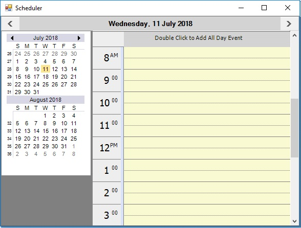
	
## Appointments

You can use the WinForms Scheduler control to create, edit, delete, and save appointment details.

### Create an appointment

Double-click a time slot in the ScheduleGrid to open the appointment form and create a new appointment.

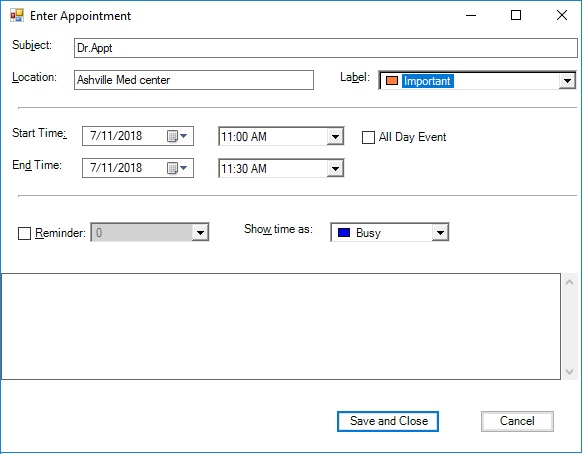

After you click Save and Close, the ScheduleControl refreshes and displays the newly created appointment. Hovering over the appointment in the ScheduleGrid shows a tooltip.

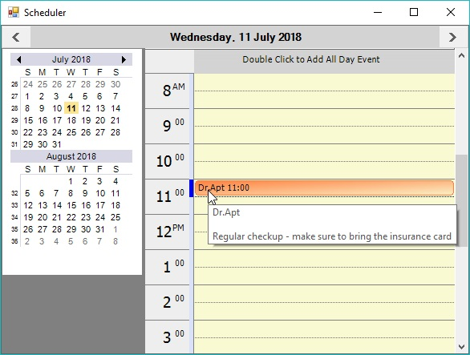

### Delete an appointment

Right-click the appointment and choose Delete Item from the context menu to remove it.

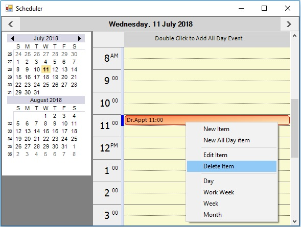

### Edit an appointment

Double-click the appointment, or right-click it and choose Edit Item from the context menu.

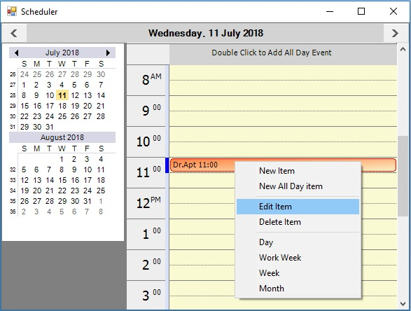

The appointment form opens with the current appointment details. Modify the required information and click Save and Close.

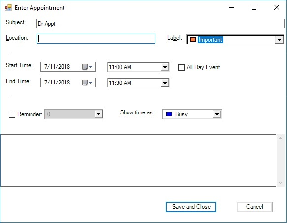

### Save appointments

After making changes, close the application. If the ScheduleControl contains unsaved changes, a confirmation dialog appears. Click Yes to save the appointment data.

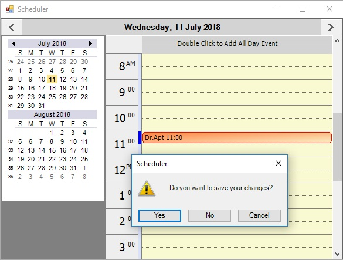
	
Then update `Form_Load` so it reloads the saved data when the file exists on disk. Copy this code to Form1.cs. Notice that the `System.IO` namespace is added through a `using` statement.



using System.IO;
using Syncfusion.Windows.Forms.Schedule;

namespace GridScheduleSample
{
	public partial class Form1 : Form
	{
	    public Form1()
		{
			InitializeComponent();
		}
		
		private void Form1_Load(object sender, EventArgs e)
		{
			SimpleScheduleDataProvider data;

			if (File.Exists("default.schedule"))
			{
				data = SimpleScheduleDataProvider.LoadBinary("default.schedule");
				data.FileName = "default.schedule";
			}
			else
			{
				data = new SimpleScheduleDataProvider();
				data.MasterList = new SimpleScheduleAppointmentList();
				data.FileName = "default.schedule";
			}
			this.scheduleControl.ScheduleType = ScheduleViewType.Month;
			this.scheduleControl.DataSource = data;
		}

	}

}


Imports Syncfusion.Windows.Forms.Schedule
Imports System.IO

Namespace GridScheduleSample

    Public Partial Class Form1
        Inherits Form

        Public Sub New()
            InitializeComponent()
        End Sub

        Private Sub Form1_Load(ByVal sender As Object, ByVal e As EventArgs)
            Dim data As SimpleScheduleDataProvider
            If File.Exists("default.schedule") Then
                data = SimpleScheduleDataProvider.LoadBinary("default.schedule")
                data.FileName = "default.schedule"
            Else
                data = New SimpleScheduleDataProvider()
                data.MasterList = New SimpleScheduleAppointmentList()
                data.FileName = "default.schedule"
            End If

            Me.scheduleControl.ScheduleType = ScheduleViewType.Month
            Me.scheduleControl.DataSource = data
        End Sub
    End Class
End Namespace



Run the application again. The Month view appears with the saved appointment.

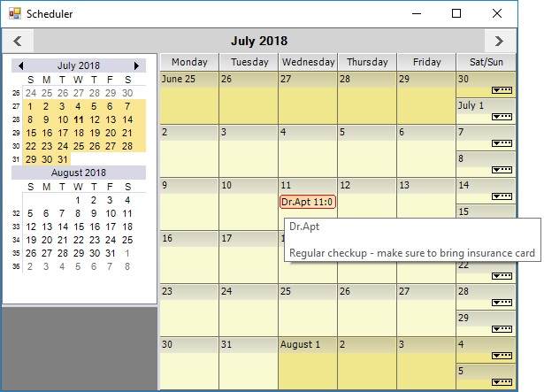

### Customize appointment text color

Use the **ForeColor** property to customize the text color displayed for an appointment.



public partial class Form1 : Form
{
    private readonly ScheduleControl scheduleControl = new();

    public Form1()
    {
        InitializeComponent();
        scheduleControl = new ScheduleControl();
        this.Controls.Add(scheduleControl);
        Load += Form1_Load;
    }
    
    private void Form1_Load(object sender, EventArgs e)
    {
        SimpleScheduleDataProvider data = new SimpleScheduleDataProvider();
        data.MasterList = new SimpleScheduleAppointmentList();
        this.scheduleControl.ScheduleType = ScheduleViewType.Month;
        this.scheduleControl.DataSource = data;

        ScheduleAppointment item = data.NewScheduleAppointment() as ScheduleAppointment;
        item.StartTime = new DateTime(DateTime.Now.Year, DateTime.Now.Month, DateTime.Now.Day, 10, 30, 0);
        item.EndTime = item.StartTime.AddHours(1);
        item.Subject = "Meeting";
        item.ForeColor = Color.Red;
        data.MasterList.Add(item);
    }

}


Imports Syncfusion.Windows.Forms.Schedule

Namespace GridScheduleSample

    Public Partial Class Form1

        Private ReadOnly scheduleControl As ScheduleControl

        Public Sub New()
            InitializeComponent()
            scheduleControl = New ScheduleControl()
            Me.Controls.Add(scheduleControl)
            AddHandler Load, AddressOf Form1_Load
        End Sub

        Private Sub Form1_Load(ByVal sender As Object, ByVal e As EventArgs)
            Dim data As SimpleScheduleDataProvider = New SimpleScheduleDataProvider()
            data.MasterList = New SimpleScheduleAppointmentList()
            data.FileName = "default.schedule"
            Me.scheduleControl.ScheduleType = ScheduleViewType.Month
            Me.scheduleControl.DataSource = data

            Dim item As ScheduleAppointment = TryCast(data.NewScheduleAppointment(), ScheduleAppointment)
            item.StartTime = New DateTime(DateTime.Now.Year, DateTime.Now.Month, DateTime.Now.Day, 10, 30, 0)
            item.EndTime = item.StartTime.AddHours(1)
            item.Subject = "Meeting"
            item.ForeColor = Color.Red
            data.MasterList.Add(item)
        End Sub
    End Class
End Namespace



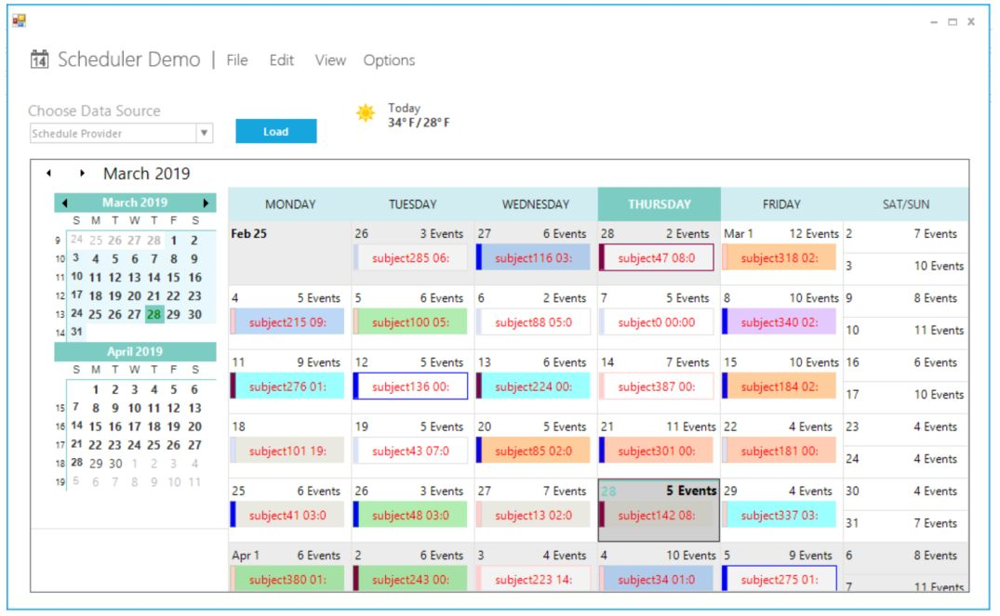

### Schedule appointment

The ScheduleDataProvider base classes provide the appointment data used by the ScheduleControl. For implementation details, refer to the `SimpleScheduleDataProvider` file included with the ScheduleSample.

#### ScheduleAppointment class

The ScheduleAppointment class represents an appointment in the Schedule control. It implements IScheduleAppointment and stores the concrete appointment data. You can derive from this class or implement IScheduleAppointment directly if you need to extend the data model. The properties exposed in ScheduleAppointment are:

* **UniqueID:** Gets or sets a unique integer associated with the item.
* **Owner:** Gets or sets an integer to identify the owner (if any) of the item.
* **StartTime:** Gets or sets the start time of the item.
* **EndTime:** Gets or sets the end time of the item.
* **Subject:** Gets or sets a text string identifying the topic of the item.
* **Content:** Gets or sets a text string holding the details or comments for the appointment item.
* **AllDay:** Gets or sets whether the appointment is an all-day appointment or not.
* **LabelValue:** Gets or sets an integer categorizer value for the item.
* **MarkerValue:** Gets or sets an integer marker value for the item.
* **Reminder:** Gets or sets the reminder associated with the appointment.
* **ReminderValue:** Gets or sets the reminder interval for the appointment.
* **LocationValue:** Gets or sets a string associated with the item.
* **Version:** Gets the version number used for appointment data format versioning.
* **Tag:** Gets or sets an arbitrary object associated with the item.
* **Dirty:** Gets or sets whether the item has been modified or not.
* **IgnoreChanges:** Gets or sets whether changes to the appointment affect the Dirty property.
* **ForeColor:** Gets or sets the text color of the item.

#### ScheduleAppointmentList class

The ScheduleAppointmentList class represents a collection of IScheduleAppointment objects used as the data source for the ScheduleControl. It wraps an ArrayList and implements IComparer to sort items by StartTime. If two appointments have the same start time, the EndTime value is used to determine their order. The following properties and methods are exposed in ScheduleAppointmentList.



/// Gets or sets the i-th IScheduleAppointment in this list.
public virtual IScheduleAppointment this[int i];

/// Gets the number of IScheduleAppointments in this list.

public virtual int Count

/// Sorts this list on the IScheduleAppointment.StartTime property.

public virtual void SortStartTime()

/// Adds an IScheduleAppointment to this list.

/// item - The IScheduleAppointment to be added.

public virtual void Add(IScheduleAppointment item)

/// Inserts an IScheduleAppointment into this list.

/// index - The position in the list where the item is to be inserted. 

/// item - The IScheduleAppointment to be inserted. 

public virtual void Insert(int index, IScheduleAppointment item)

/// Removes an IScheduleAppointment from this list.

/// item - The IScheduleAppointment to be removed. 

public virtual void Remove(IScheduleAppointment item)

/// Removes an IScheduleAppointment from this list.

/// index - The position of the item to be removed.

public virtual void RemoveAt(int index)

/// Returns the position of the specified item within this list.

/// item - The search item. 

public virtual int IndexOf(IScheduleAppointment item)

/// Returns a new ScheduleAppointment populated with default values.

public virtual IScheduleAppointment NewScheduleAppointment()


'Gets or sets the i-th IScheduleAppointment in this list.
Public Overridable Default Property Item(ByVal i As Integer) As IScheduleAppointment
'Gets the number of IScheduleAppointments in this list.
Public Overridable Count As Integer
'Sorts this list on the IScheduleAppointment.StartTime property.
Public Overridable Sub SortStartTime()
'Adds an IScheduleAppointment to this list.
'item - The IScheduleAppointment to be added.
Public Overridable Sub Add(ByVal item As IScheduleAppointment)
'Inserts an IScheduleAppointment into this list.
'index - The position in the list where the item is to be inserted.
'item - The IScheduleAppointment to be inserted.
Public Overridable Sub Insert(ByVal index As Integer, ByVal item As IScheduleAppointment)
'Removes an IScheduleAppointment from this list.
'item - The IScheduleAppointment to be removed.
Public Overridable Sub Remove(ByVal item As IScheduleAppointment)
'Removes an IScheduleAppointment from this list.
'index - The position of the item to be removed.
Public Overridable Sub RemoveAt(ByVal index As Integer)
'Returns the position of the specified item within this list.
'item - The search item.
Public Overridable Function IndexOf(ByVal item As IScheduleAppointment) As Integer
'Returns a new ScheduleAppointment populated with default values.
Public Overridable Function NewScheduleAppointment() As IScheduleAppointment



#### ScheduleDataProvider class

The ScheduleDataProvider class provides two primary responsibilities:

1. It provides a base implementation of IScheduleDataProvider that enables derived classes to supply custom functionality through method overrides. The virtual methods exposed in ScheduleDataProvider have empty implementations, so you must derive from this class to use it.
2. It provides the data used by the appointment editor drop-down lists. For this second role, ScheduleDataProvider supplies concrete implementations for the virtual methods it exposes. In most cases, the base class gives you the default lists, but you can override them to customize the labels, markers, reminders, locations, and owners. The following methods are available for appointment data management and can be overridden in derived classes.



/// Return an IScheduleAppointmentList holding the schedule items for the given date. 
public virtual IScheduleAppointmentList GetScheduleForDay(DateTime day)
//// Return an IScheduleAppointmentList holding the schedule items between the given dates.
public virtual IScheduleAppointmentList GetSchedule(DateTime startDate, DateTime endDate)
/// Return an IScheduleAppointmentList holding the schedule items for a particular owner on the given date. 
public virtual IScheduleAppointmentList GetScheduleForDay(DateTime day, int owner)
/// Return an IScheduleAppointmentList holding the schedule items for a particular owner between the given dates.
public virtual IScheduleAppointmentList GetSchedule(DateTime startDate, DateTime endDate, int owner)
/// Saves any modified ScheduleAppointments.
public virtual void CommitChanges()
/// Gets or sets whether CommitChanges is called when the ScheduleControl is disposed.
public SaveOnCloseBehavior SaveOnCloseBehaviorAction
/// Gets or sets whether data source is modified or not.
public virtual bool IsDirty
/// Returns a new ScheduleAppointment populated with default values.
public virtual IScheduleAppointment NewScheduleAppointment()
/// Adds a ScheduleAppointment to the list.
public virtual void AddItem(IScheduleAppointment item)
/// Removes a ScheduleAppointment from the list. 
public virtual void RemoveItem(IScheduleAppointment item)


'Return an IScheduleAppointmentList holding the schedule items for the given date.
Public Overridable Function GetScheduleForDay(ByVal day As DateTime) As IScheduleAppointmentList
'Return an IScheduleAppointmentList holding the schedule items between the given dates.
Public Overridable Function GetSchedule(ByVal startDate As DateTime, ByVal endDate As DateTime) As IScheduleAppointmentList
'Return an IScheduleAppointmentList holding the schedule items for a particular owner on the given date. 
Public Overridable Function GetScheduleForDay(ByVal day As DateTime, ByVal owner As Integer) As IScheduleAppointmentList
'Return an IScheduleAppointmentList holding the schedule items for a particular owner between the given dates.
Public Overridable Function GetSchedule(ByVal startDate As DateTime, ByVal endDate As DateTime, ByVal owner As Integer) As IScheduleAppointmentList
'Saves any modified ScheduleAppointments.
Public Overridable Sub CommitChanges()
'Gets or sets whether CommitChanges is called when the ScheduleControl is disposed.
Public SaveOnCloseBehaviorAction As SaveOnCloseBehavior
'Gets or sets whether data source is modified or not.
Public Overridable IsDirty As Boolean
'Returns a new ScheduleAppointment populated with default values.
Public Overridable Function NewScheduleAppointment() As IScheduleAppointment
'Adds a ScheduleAppointment to the list.
Public Overridable Sub AddItem(ByVal item As IScheduleAppointment)
'Removes a ScheduleAppointment from the list.
Public Overridable Sub RemoveItem(ByVal item As IScheduleAppointment)



Here are the methods and properties used as part of the ScheduleDataProvider's second role, which provides the drop-down list data. The following implementation shows the exposed functionality.



/// Provides default drop lists for entering IScheduleAppointment data. 

/// You can override this method to provide customized drop lists.

public virtual void InitLists()
{
labelList = new ListObjectList();
labelList.Add(new ListObject(0,"None", Color.White)); 
labelList.Add(new ListObject(1,"Important", Color.FromArgb(255,128,64)));
labelList.Add(new ListObject(2,"Business",  Color.FromArgb(86,152,233)));
labelList.Add(new ListObject(3,"Personal",  Color.FromArgb(57,210,53)));
labelList.Add(new ListObject(4,"Vacation",  Color.FromArgb(199,198,182)));
labelList.Add(new ListObject(5,"Must Attend",  Color.FromArgb(255,128,0)));
labelList.Add(new ListObject(6,"Travel Required",  Color.FromArgb(0,255,255)));
labelList.Add(new ListObject(7,"Needs Preparation",  Color.FromArgb(171,171,88)));
labelList.Add(new ListObject(8,"Birthday",  Color.FromArgb(186,117,255)));
labelList.Add(new ListObject(9,"Anniversary",  Color.FromArgb(255,128,64)));
labelList.Add(new ListObject(10,"Phone Call",  Color.FromArgb(255,128,64)));
markerList = new ListObjectList();

//same as no Mark Color
markerList.Add(new ListObject(0,"Free", Color.FromArgb(50, Color.RoyalBlue)));
markerList.Add(new ListObject(1,"Tentative", Color.FromArgb(255, 206, 206)));
markerList.Add(new ListObject(2,"Busy",  Color.FromArgb(0,0,242)));
markerList.Add(new ListObject(3,"Out of Office",  Color.FromArgb(128, 0 ,64)));
reminderList = new ListObjectList();
reminderList.Add(new ListObject(0,"0 minutes", Color.White)); 
reminderList.Add(new ListObject(1,"5 minutes", Color.White)); 
reminderList.Add(new ListObject(2,"10 minutes", Color.White)); 
reminderList.Add(new ListObject(3,"15 minutes", Color.White)); 
reminderList.Add(new ListObject(4,"30 minutes", Color.White)); 
reminderList.Add(new ListObject(5,"1 hour", Color.White)); 
reminderList.Add(new ListObject(6,"2 hours", Color.White)); 
reminderList.Add(new ListObject(7,"3 hours", Color.White)); 
reminderList.Add(new ListObject(8,"4 hours", Color.White)); 
this.locationList = new ListObjectList();
locationList.Add(new ListObject(0,"", Color.White)); 
locationList.Add(new ListObject(1,"RoomB", Color.White)); 
locationList.Add(new ListObject(2,"RoomC", Color.White)); 
locationList.Add(new ListObject(3,"RoomD", Color.White)); 
locationList.Add(new ListObject(4,"RoomE", Color.White)); 
}

/// Returns the list for the LabelValue options.

public virtual ILookUpObjectList GetLabels()
{
   return LabelList;
}

/// Gets or sets the list for the LabelList options.
protected ListObjectList LabelList
{
   get{return labelList;}
   set{labelList = value;}
}

/// Returns the list for the ReminderValue options.

public virtual ILookUpObjectList GetReminders()
{
   return ReminderList;
}

/// Gets or sets the list for the ReminderValue options.

protected ListObjectList ReminderList
{
   get{return reminderList;}
   set{reminderList = value;}
}

/// Returns the list for the MarkerValue options.

public virtual ILookUpObjectList GetMarkers()
{
   return MarkerList;
}

/// Gets or sets the list for the MarkerValue options.

protected ListObjectList MarkerList
{
   get{return markerList;}
   set{markerList = value;}
}

/// Returns the list for the LocationValue options.

public virtual ILookUpObjectList GetLocations()
{
   return LocationList;
}

/// Gets or sets the list for the LocationValue options.

protected ListObjectList LocationList
{
   get{return locationList;}
   set{locationList = value;}
}

/// Returns the list for the Owner options.

public virtual ILookUpObjectList GetOwners()
{
return OwnerList;
}

/// Gets or sets the list for the Owner options.

protected ListObjectList OwnerList
{
   get{return ownerList;}
   set{ownerList = value;}
}


'Provides default drop lists for entering IScheduleAppointment data. 

'You can override this method to provide customized drop lists.
Public Overridable Sub InitLists()
    labelList = New ListObjectList()
    labelList.Add(New ListObject(0, "None", Color.White))
    labelList.Add(New ListObject(1, "Important", Color.FromArgb(255, 128, 64)))
    labelList.Add(New ListObject(2, "Business", Color.FromArgb(86, 152, 233)))
    labelList.Add(New ListObject(3, "Personal", Color.FromArgb(57, 210, 53)))
    labelList.Add(New ListObject(4, "Vacation", Color.FromArgb(199, 198, 182)))
    labelList.Add(New ListObject(5, "Must Attend", Color.FromArgb(255, 128, 0)))
    labelList.Add(New ListObject(6, "Travel Required", Color.FromArgb(0, 255, 255)))
    labelList.Add(New ListObject(7, "Needs Preparation", Color.FromArgb(171, 171, 88)))
    labelList.Add(New ListObject(8, "Birthday", Color.FromArgb(186, 117, 255)))
    labelList.Add(New ListObject(9, "Anniversary", Color.FromArgb(255, 128, 64)))
    labelList.Add(New ListObject(10, "Phone Call", Color.FromArgb(255, 128, 64)))
    markerList = New ListObjectList()
    markerList.Add(New ListObject(0, "Free", Color.FromArgb(50, Color.RoyalBlue)))
    markerList.Add(New ListObject(1, "Tentative", Color.FromArgb(255, 206, 206)))
    markerList.Add(New ListObject(2, "Busy", Color.FromArgb(0, 0, 242)))
    markerList.Add(New ListObject(3, "Out of Office", Color.FromArgb(128, 0, 64)))
    reminderList = New ListObjectList()
    reminderList.Add(New ListObject(0, "0 minutes", Color.White))
    reminderList.Add(New ListObject(1, "5 minutes", Color.White))
    reminderList.Add(New ListObject(2, "10 minutes", Color.White))
    reminderList.Add(New ListObject(3, "15 minutes", Color.White))
    reminderList.Add(New ListObject(4, "30 minutes", Color.White))
    reminderList.Add(New ListObject(5, "1 hour", Color.White))
    reminderList.Add(New ListObject(6, "2 hours", Color.White))
    reminderList.Add(New ListObject(7, "3 hours", Color.White))
    reminderList.Add(New ListObject(8, "4 hours", Color.White))
    Me.locationList = New ListObjectList()
    locationList.Add(New ListObject(0, "", Color.White))
    locationList.Add(New ListObject(1, "RoomB", Color.White))
    locationList.Add(New ListObject(2, "RoomC", Color.White))
    locationList.Add(New ListObject(3, "RoomD", Color.White))
    locationList.Add(New ListObject(4, "RoomE", Color.White))
End Sub
'Returns the list for the LabelValue options.
Public Overridable Function GetLabels() As ILookUpObjectList
    Return LabelList
End Function
' Gets or sets the list for the LabelList options.
Protected Property LabelList As ListObjectList
    Get
        Return labelList
    End Get

    Set(ByVal value As ListObjectList)
        labelList = value
    End Set
End Property
'Returns the list for the ReminderValue options.
Public Overridable Function GetReminders() As ILookUpObjectList
    Return ReminderList
End Function
'Gets or sets the list for the ReminderValue options.
Protected Property ReminderList As ListObjectList
    Get
        Return reminderList
    End Get

    Set(ByVal value As ListObjectList)
        reminderList = value
    End Set
End Property
'Returns the list for the MarkerValue options.
Public Overridable Function GetMarkers() As ILookUpObjectList
    Return MarkerList
End Function
'Gets or sets the list for the MarkerValue options.
Protected Property MarkerList As ListObjectList
    Get
        Return markerList
    End Get

    Set(ByVal value As ListObjectList)
        markerList = value
    End Set
End Property
'Returns the list for the LocationValue options.
Public Overridable Function GetLocations() As ILookUpObjectList
    Return LocationList
End Function
'Gets or sets the list for the LocationValue options.
Protected Property LocationList As ListObjectList
    Get
        Return locationList
    End Get

    Set(ByVal value As ListObjectList)
        locationList = value
    End Set
End Property
'Returns the list for the Owner options.
Public Overridable Function GetOwners() As ILookUpObjectList
    Return OwnerList
End Function
'Gets or sets the list for the Owner options.
Protected Property OwnerList As ListObjectList
    Get
        Return ownerList
    End Get

    Set(ByVal value As ListObjectList)
        ownerList = value
    End Set
End Property



## Recurrence appointment

The WinForms Scheduler control supports recurring appointments. You can configure daily, weekly, monthly, or yearly recurrence patterns and optionally specify an end date. Details are explained in the following link:

[Create the recurrence appointment in WinForms Scheduler control](time-interval.md)

N> You can also explore our [WinForms Scheduler example](https://github.com/syncfusion/winforms-demos/tree/master/schedulecontrol) to learn how to manage appointments through an intuitive user interface similar to Microsoft Outlook. For additional information about features, documentation, and samples, visit the [WinForms Scheduler](https://www.syncfusion.com/winforms-ui-controls/scheduler) page.
