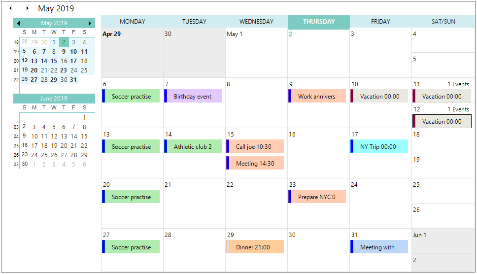

# Metro Theme in Windows Forms Scheduler

The Schedule control supports Metro styling, which allows you to provide a modern and consistent user interface. You can apply the Metro theme by setting the appropriate visual style for the control. 

## Use case scenario

Use the Metro theme to provide a modern appearance for the Schedule control and maintain visual consistency across your application.

## Property

<table>
<tr>
<th>
Property</th><th>
Description</th></tr>
<tr>
<td>
VisualStyle</td><td>
Gets or sets the visual style applied to the Schedule control. Supported styles include Office2010, Office2007, Office2003, Metro, and other available themes.</td></tr>
</table>

## Event

<table>
<tr>
<th>
Event</th><th>
Parameters</th><th>
Description</th></tr>
<tr>
<td>
ThemeChanged</td><td>
Object sender, EventArgs e</td><td>
Occurs when the ThemesEnabled property is changed.</td></tr>
</table>

## Apply the Metro Theme

To apply the Metro theme, set the `VisualStyle` property of the Schedule control to `GridVisualStyles.Metro`.



using Syncfusion.Windows.Forms.Schedule;

this.scheduleControl1.GetScheduleHost().Schedule.Appearance.VisualStyle = Syncfusion.Windows.Forms.GridVisualStyles.Metro;


Imports Syncfusion.Windows.Forms.Schedule

Me.scheduleControl1.GetScheduleHost().Schedule.Appearance.VisualStyle = Syncfusion.Windows.Forms.GridVisualStyles.Metro



