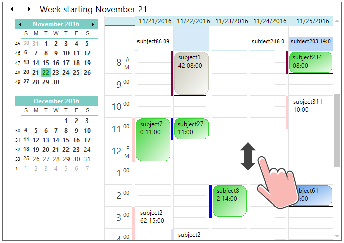
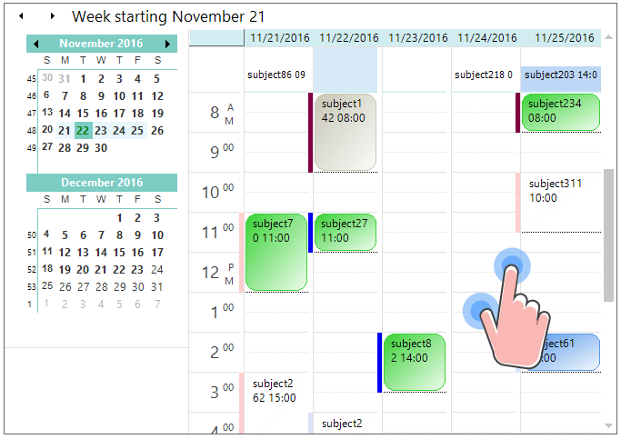

# Touch Support in Windows Forms Scheduler

The Windows Forms ScheduleControl supports touch-based interactions similar to those available in Microsoft Outlook Calendar. When touch mode is enabled, users can navigate and interact with the scheduler using gestures such as swiping, panning, and zooming.

## Enable Touch Support

To enable touch support, set the [EnableTouchMode](https://help.syncfusion.com/cr/windowsforms/Syncfusion.Windows.Forms.Schedule.ScheduleControl.html#Syncfusion_Windows_Forms_Schedule_ScheduleControl_EnableTouchMode) property to `true`. When enabled, the grid supports swiping, panning, and zooming. The default value of `EnableTouchMode` is `false`.



using Syncfusion.Windows.Forms.Schedule;

//Enable the touch mode.
scheduleControl1.EnableTouchMode = true;


Imports Syncfusion.Windows.Forms.Schedule

'Enable the touch mode.
scheduleControl1.EnableTouchMode = True



## Touch swiping

The ScheduleControl supports vertical swipe scrolling in Day, WorkWeek, and custom views. The previous or next period can be displayed by swiping horizontally from left to right or right to left, similar to the Outlook calendar.

## Touch zooming

The ScheduleControl view can be changed by zooming, similar to the Outlook calendar.

